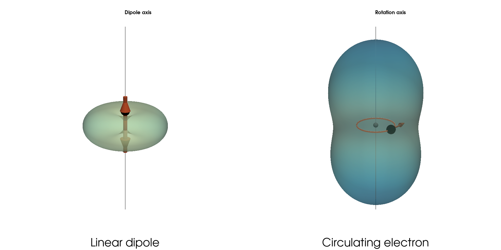
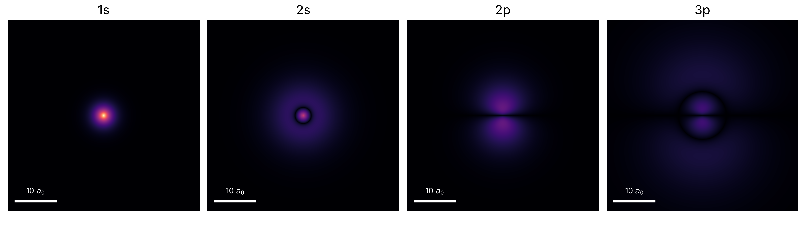
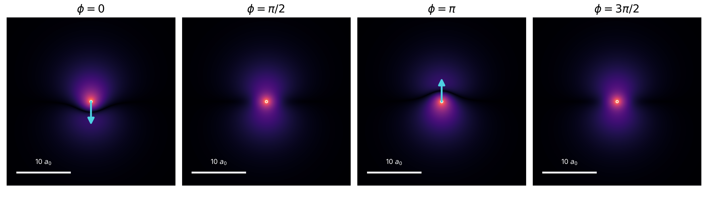
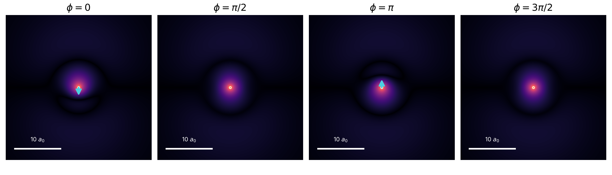

# Why Do Atoms Radiate?

  

*Classical physics predicts that atoms should collapse. Quantum mechanics makes them stable. So why do excited atoms still emit light?*

  

**Status:** Working outline, 26 October 2026

**Series:** Atomic Radiation, Post 1

**Purpose:** Establish the classical instability of atoms, explain how quantum stationary states resolve it, and end with the open question of spontaneous emission.

  

## Figure list (current numbering)

  

1. Radiation patterns of a linear and a circulating dipole (PyVista, 3D)

2. Static hydrogen clouds: 1s, 2s, 2p, 3p (matplotlib, cross-sections)

3. 1s–2p superposition at four phases, with dipole arrow

4. 1s–3p superposition at four phases (same scales as Fig. 3)

5. 1s–2s superposition at four phases (same scales, no dipole)

  

---

  

## 1. The atom that shouldn't exist

  

### Opening: start with antennas

- A radio transmitter is charges sloshing back and forth in a wire, and the wire radiates.

- A receiving antenna is the same wire run in reverse. The wave shakes the charges, and we read the signal.

- An atom is a very small antenna, so we ask whether it behaves like one.

  

### The oscillating dipole

- The dipole moment is charge times displacement. For an electron at position $\mathbf{x}$ from the nucleus, $\mathbf{p} = -e\,\mathbf{x}$.

- If the electron swings back and forth, $p(t) = p_0 \cos\omega t$, where $p_0$ is the amplitude: the charge times how far it swings.

- The average radiated power is

  

$$P = \frac{\mu_0\,\omega^4\,p_0^2}{12\pi c}.$$

  

- Why $\omega^4$: the acceleration is $\omega^2 x$, and the power goes as acceleration squared. Doubling the frequency gives 16 times the power at the same swing (this is also why the sky is blue).

- Why $p_0^2$: the radiated field is proportional to $p_0$, and the power to the field squared.

- The radiation is not sent equally in all directions (Figure 1).

  

  
> Caption **Figure 1. Radiation from a dipole. Left: a charge oscillating along a line radiates in a doughnut-shaped pattern, with power proportional to $\sin^2\theta$. It is strongest sideways and zero along the axis of oscillation. Right: a charge circulating in a plane is two linear dipoles at right angles and a quarter period apart. Its pattern, proportional to $1+\cos^2\theta$, is never zero, and it radiates twice the total power of a single linear dipole with the same $p_0$. Both panels share one scale.**

  

### The circulating electron

- A circular orbit is two linear oscillations at 90° in space and 90° in phase.

- The cross terms average out and the powers add, so the total is constant in time:

  

$$P = \frac{\mu_0\,\omega^4\,p_0^2}{6\pi c}.$$

  

- For circular motion $p_0 = e\,a_0$, with $a_0$ the orbit radius. This is the Larmor formula for $a = \omega^2 a_0$.

  

### Plugging in the Bohr atom

- $p_0 = e\,a_0 \approx 8.5\times10^{-30}$ C·m.

- $\omega = v/a_0 \approx 4.1\times10^{16}$ rad/s, one orbit every 152 as.

- $P \approx 4.7\times10^{-8}$ W: tiny in watts, huge for an atom.

- Binding energy 13.6 eV $= 2.2\times10^{-18}$ J. Energy divided by power gives a lifetime of about 47 ps.

- The dipole formula needs the source to be much smaller than the wavelength: orbit 0.053 nm, wavelength about 46 nm, so it holds.

  

### A more careful estimate

- The 47 ps estimate assumes the power stays at its starting value.

- In reality the orbit shrinks, the acceleration grows, and the power rises as $1/r^4$. Integrating the collapse gives a time exactly 3 times shorter, about 16 ps.

- The energy comes out of the electron because its own retarded field acts back on it with a force opposing its motion (radiation reaction, the Abraham–Lorentz force):

  

$$\mathbf F_{\mathrm{AL}} = \frac{e^2}{6\pi\varepsilon_0 c^3}\,\dot{\mathbf a}, \qquad \dot{\mathbf a} = -\omega^2\mathbf v \ \text{(circular motion)}.$$

  

- Both estimates are nonrelativistic. Either way, a classical atom would last picoseconds.

  

### Bridge

- Classical physics says atoms are unstable, yet they exist. What changes when the electron is described quantum mechanically?

  

---

  

## 2. Quantum mechanics to the rescue

  

### Purpose

- Introduce stationary states without deriving the hydrogen atom.

  

### Bullets

- Replace the classical orbit by a wavefunction $\psi(\mathbf r)$.

- Hydrogen has discrete energy eigenstates, each with its own energy $E_n$:

  

$$\hat H\psi_n = E_n\psi_n.$$

  

- Time dependence of an eigenstate is only a phase:

  

$$\Psi_n(\mathbf r,t) = \psi_n(\mathbf r)\,e^{-iE_nt/\hbar}, \qquad |\Psi_n(\mathbf r,t)|^2 = |\psi_n(\mathbf r)|^2.$$

  

- So the probability density, the "electron cloud", does not change in time. Nothing moves, so nothing accelerates and nothing radiates.

- The cloud does not orbit the nucleus like a classical particle.

- This resolves the classical collapse for the isolated atom: a stationary state has no oscillating dipole, so the radiation formula of Section 1 gives zero.

- Excited states are also stationary solutions of the isolated-atom Hamiltonian, which sets up the paradox at the end.

- Show 1s, 2s, 2p and 3p, the states used in the next section.

  

### Figure 2

*(four cross-sections, common spatial scale and brightness scale)*

  

>  Caption **Figure 2. Stationary states of hydrogen. Probability density $|\psi|^2$ in a plane through the nucleus for 1s, 2s, 2p and 3p, on a common spatial scale and a common (gamma-compressed) brightness scale. Each cloud is the same at every moment: the time dependence of a stationary state is only a phase, which drops out of $|\psi|^2$.**

  

### Bridge

- A single stationary state is static. But quantum mechanics also allows superpositions of different stationary states. What does the cloud do then?

  

---

  

## 3. When electron clouds oscillate

  

### Purpose

- Show that a superposition makes the cloud, and the dipole, oscillate, and that the dipole strength depends on the orbitals.

  

### Bullets

- Superpose two eigenstates with amplitudes $c_g$, $c_e$:

  

$$|\Psi(t)\rangle = c_g e^{-iE_gt/\hbar}|g\rangle + c_e e^{-iE_et/\hbar}|e\rangle.$$

  

- The relative phase advances as $\phi = (E_e - E_g)t/\hbar$, so the interference term between the two orbitals oscillates at

  

$$\omega_{eg} = \frac{E_e - E_g}{\hbar}.$$

  

- For real orbitals and equal weights: $|\Psi|^2 = \tfrac12(\psi_g^2 + \psi_e^2) + \psi_g\psi_e\cos\phi$.

- The dipole moment follows the sloshing of the cloud. The operator is $\hat{\mathbf d} = -e\mathbf r$ and its mean value is

  

$$\langle d_z\rangle = 2\,c_g c_e\,d_{ge}\cos\phi, \qquad d_{ge} = -e\langle g|z|e\rangle.$$

  

- Strength depends on the orbitals through the transition dipole $d_{ge}$.

- Connection to Section 1: an oscillating dipole radiates with $p_0 = 2|c_g||c_e||d_{ge}|$. In terms of the decay rate $\Gamma = \omega^3 d_{ge}^2/(3\pi\varepsilon_0\hbar c^3)$ the mean power is $\hbar\omega\,\Gamma\,|c_g|^2|c_e|^2$.

- The arrows in Figures 3–5 show the dipole moment $d = -e\langle z\rangle$, not the cloud. They point opposite to the displacement of the cloud, and are magnified ×6 equally in all three figures.

  

### Figure 3: strong dipole, 1s–2p

>Caption **Figure 3. A strong oscillating dipole. Coherent equal superposition of hydrogen 1s and 2p at four moments of one period. The cloud sloshes along the z axis and the arrow shows the electric dipole moment, which oscillates with amplitude $0.745\,ea_0$.**

  

### Figure 4: weaker dipole, 1s–3p

>Caption **Figure 4. A weaker oscillating dipole. With 3p instead of 2p the cloud is more extended and the radial node causes partial cancellation in the dipole integral. The amplitude is $0.298\,ea_0$, 40% of the 1s–2p value. Same scales as Figure 3.**

  

### Figure 5: oscillating cloud, no dipole, 1s–2s

>Caption **Figure 5. An oscillating cloud without a dipole. The density changes in time, with a node ring that appears and fills in, but the cloud stays spherically symmetric, so its center of charge never moves and the dipole is exactly zero.**

  

### Bridge

- We now have a quantum atom with an oscillating dipole, which radiates like the classical antenna. But what if the atom is prepared in a single excited eigenstate, not a superposition?

  

---

  

## 4. So why do excited atoms radiate?

  

### Purpose

- End with the unresolved paradox of spontaneous emission.

  

### Bullets

- Return to a single excited eigenstate: static cloud, no oscillating mean dipole, so the classical antenna argument gives no radiation.

- Yet excited hydrogen decays: the 2p state has a lifetime of about 1.6 ns.

- The rate $\Gamma$ that sets the radiated power of a superposition also sets the decay of a state with no oscillating dipole.

- Einstein's 1917 treatment introduced the spontaneous-emission coefficient $A$ and left the timing and direction of each event to chance.

- The atomic wavefunction alone does not explain the physical origin of spontaneous emission.

- End with the missing mechanism, not its solution.

  

**Closing question:** If an excited atom has a stationary electron cloud, what makes it emit a photon?

  

---

  

## Scope boundaries

  

Not in this post: quantization of the electromagnetic field, vacuum fluctuations, the Purcell effect, radiation reaction as an explanation of spontaneous emission, the DDC split between vacuum fluctuations and radiation reaction, and the Unruh effect. These belong in later posts.

  

## Open work

  

- Verify in a script: 47 ps, 16 ps, $P \approx 4.7\times10^{-8}$ W, $\omega$ and the 152 as orbit time (so far computed by hand). The transition dipoles (0.745, 0.298, 0) are already verified numerically.

- Check the classical collapse derivation and its assumptions.

- Decide whether the radiation-reaction picture (kink figure or extended-charge sketch) gets its own figure or stays in the text.

- Locate the precise Griffiths discussion of the electromagnetic self-force.

- Verify Einstein's 1917 quotation, translation and source before quoting it.

- Optional: animated version of Figures 3–5 (loop over $\phi$).

- Write the article section by section.