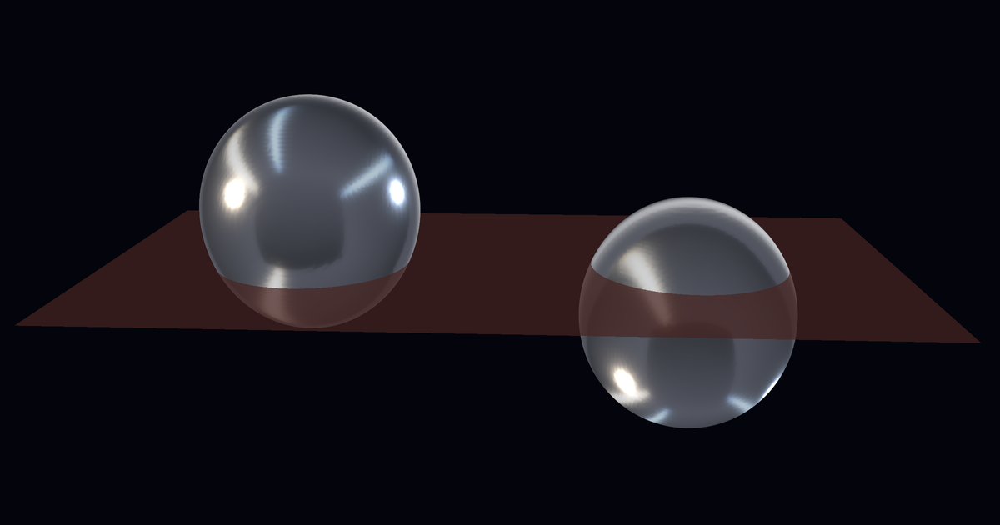
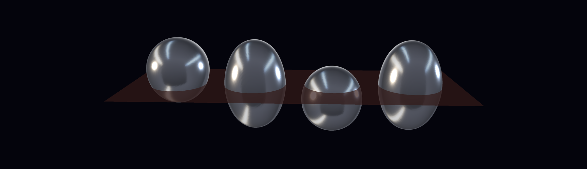
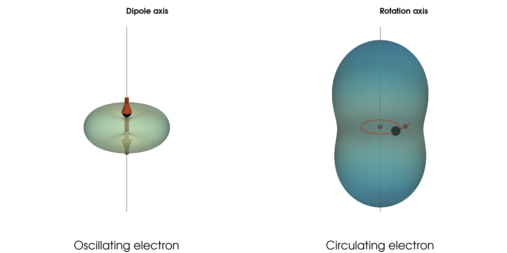
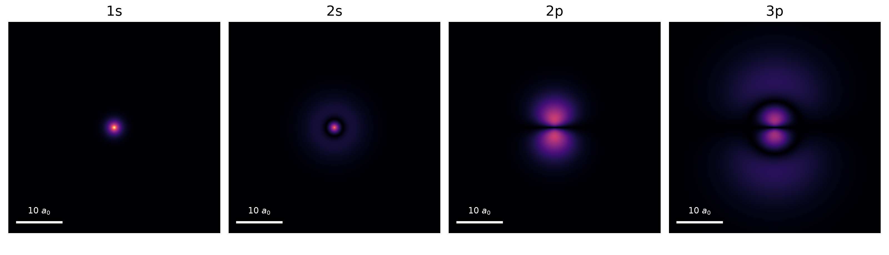
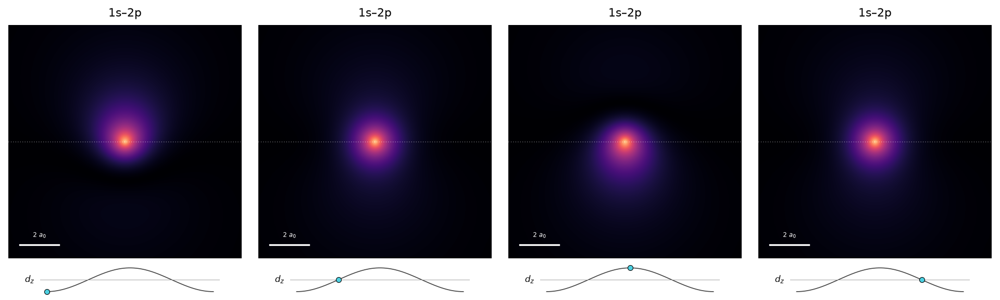
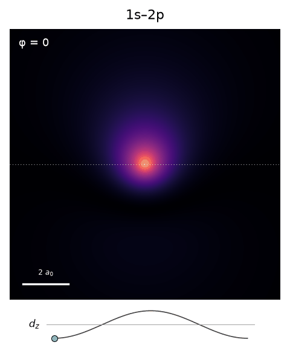
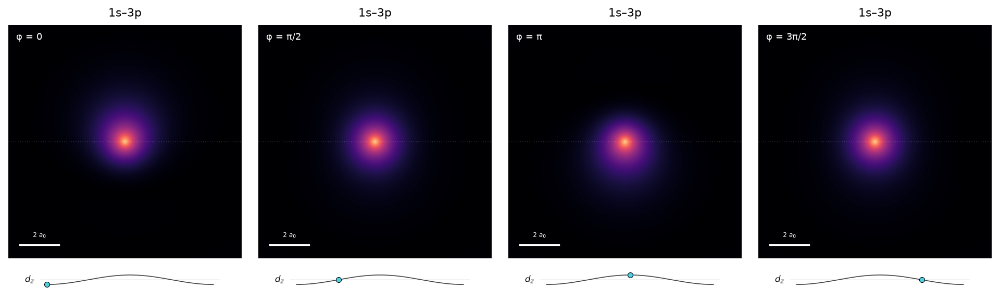
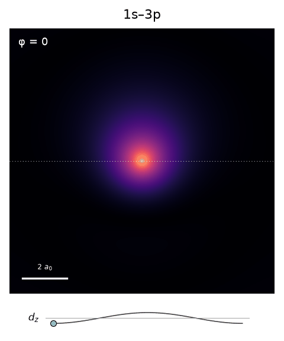
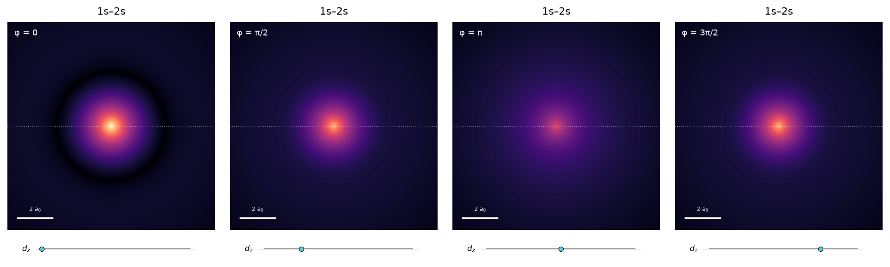
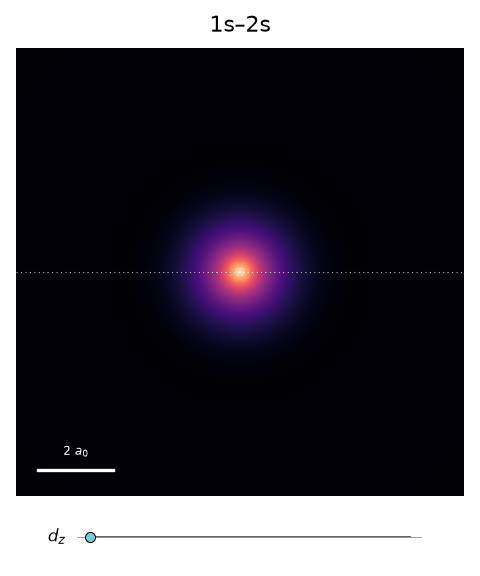

# Why Do Atoms Radiate?
## Classical physics predicts that atoms should collapse. Quantum mechanics makes them stable. So why do excited atoms still emit light?

> Caption: **A hydrogen atom in a superposition of 1s and 2p, shown at two moments half an oscillation period apart. Each metallic surface encloses half of the electron probability. At φ = 0 (left) the cloud sits above the plane z = 0, half a period later (φ = π, right) it sits below it. These are two snapshots of one atom, not two objects. The sloshing of charge is an oscillating electric dipole, and an oscillating dipole radiates.**
> Alt text: Two glossy metallic egg-shaped surfaces side by side on a dark background, with a faint translucent horizontal plane between them. The left surface sits mostly above the plane, the right one is its mirror image and sits mostly below it, so each is cut by the plane.
> Source: Image created by author using PyVista (50%-probability isosurface of the electron density).

> Caption: **A hydrogen atom in a coherent superposition of 1s and 2p, shown at four moments during one oscillation period. From left to right, the relative phases are φ = 0, π/2, π and 3π/2. Each metallic surface encloses 50% of the electron probability, on the same spatial scale. The translucent plane marks z = 0. As the relative phase changes, the electron cloud shifts from one side of the nucleus to the other and back, producing an oscillating electric dipole. These are four snapshots of the same atom, not four different orbitals.**
> Alt text: Four glossy metallic egg-shaped surfaces side by side on a dark background, with a faint translucent horizontal plane between them. The left surface sits mostly above the plane, the third one is its mirror image and sits mostly below it, so each is cut by the plane. Number two and four are symmetric with respect to the plane.
> Source: Image created by author using PyVista (50%-probability isosurface of the electron density).

An atom should not exist. We often imagine the electron as a tiny planet circling around the nucleus. The problem is that a circling charge radiates, loses energy and spirals inward. For hydrogen the collapse due to this mechanism would take about sixteen picoseconds. Yet, atoms around us have been stable for billions of years.

Quantum mechanics removes the orbit. An electron in an atom is described by a cloud of probability that does not change in time, and a cloud that does not change has no oscillating dipole, so the classical antenna picture predicts no radiation. This leads to stable atoms. In this framework we introduce radiation by allowing the electron to be in a superposition of these stable clouds. The resulting interference makes the probability slosh back and forth, and we are left with an oscillating dipole. The frequency and strength are fixed by the quantum states. This explains which transitions in an atom light up, how strongly, and which stay dark.

It also sets a trap. An atom prepared in a single excited state has a perfectly static cloud and no oscillating dipole at all. By everything above, it should sit there and shine nothing. Yet it decays, within nanoseconds, at exactly the rate the antenna picture predicts for a superposition.

## The Atom That Shouldn't Exist

In a radio antenna the transmitter pushes electrons back and forth along a wire, and the wire radiates. A receiving antenna is the same wire run in reverse. The incoming wave shakes the electrons, and we read the signal from their motion. Either way, the physics is charge sloshing along a line.

An atom is a very small antenna, so it is fair to ask whether it behaves like one.

The quantity that matters is the dipole moment: charge times displacement. For an electron at position **x** from the nucleus it is **p** = −e**x**. If the electron swings back and forth, *p*(*t*) = *p*₀ cos(ω*t*), where *p*₀ is the amplitude, the charge times how far it swings. The average power radiated by such an oscillating dipole [1] is

$$
P = \frac{\mu_0\,\omega^4\,p_0^2}{12\pi c}
$$

The power grows with the square of the amplitude *p*₀, and with the fourth power of the frequency. Doubling the frequency at the same amplitude gives sixteen times the power. The same ω⁴ is the main reason the sky is blue, since air molecules are driven by sunlight and re-radiate as small dipoles. (Rayleigh scattering also depends on how strongly the molecules polarize, but the fourth power of the frequency dominates.)

The radiation is not sent equally in all directions. A charge oscillating along a line radiates in a doughnut-shaped pattern: strongest sideways, and zero along the axis of oscillation. A charge going round in a circle consists of two oscillations, at right angles and a quarter period apart. The total power is twice that of a single linear dipole with the same *p*₀ (Figure 1).

> Caption: **Figure 1. Radiation from a dipole. Left: a charge oscillating along a line radiates in a doughnut-shaped pattern, with power proportional to sin²θ. It is strongest sideways and zero along the axis of oscillation. Right: a charge circulating in a plane is two linear dipoles at right angles and a quarter period apart. Its pattern, proportional to 1 + cos²θ, is never zero, and it radiates twice the total power of a single linear dipole with the same p₀. Both panels share one scale. The distance of the surface from the centre shows how much power goes in that direction. It is not the shape of the wave.**
> Alt text: Two 3D radiation patterns around a vertical axis. Left, labelled "Oscillating electron" with the axis labelled "Dipole axis": a flat, light-green doughnut with a small electron and arrow on the axis, pinched to zero along the axis. Right, labelled "Circulating electron" with the axis labelled "Rotation axis": a much larger blue peanut-shaped surface, elongated along the axis with a narrow waist, enclosing a small circular orbit with an electron.
> Source: Image by author.

To see how big this effect is, take the simplest picture of hydrogen: an electron on a circular orbit, held there by the Coulomb attraction to the nucleus. The attraction should be equal to the force needed to keep the electron on its circle. Classical physics does not say how large the orbit should be, so we take the observed size of hydrogen, *a*₀ = 0.053 nm, as its radius. That gives a binding energy of 13.6 eV, a speed of 2.2×10⁶ m/s (about one percent of the speed of light) and an orbital frequency ω = v/*a*₀ ≈ 4.1×10¹⁶ rad/s, one orbit every 152 attoseconds.

The dipole amplitude is the charge times the orbit radius, *p*₀ = *e* *a*₀ ≈ 8.5×10⁻³⁰ C·m. For a circular orbit the radiated power is twice the value the formula above gives for a linear dipole (the factor 12π becomes 6π), which comes to about 4.7×10⁻⁸ W. That is a tiny number in watts, but enormous compared to the binding energy: dividing energy by power gives a lifetime of about 47 picoseconds.

The antenna picture is legitimate here. The dipole formula needs the source to be much smaller than the wavelength, and it is: the orbit is about 0.1 nm across, the emitted wavelength is about 46 nm. The calculation does not take into account that the electron spirals inward when it loses energy. Taking this into account gives a time exactly three times shorter, about 16 picoseconds: a classical atom would last picoseconds.

From the energy balance we can conclude that the atom is unstable, but what is the force acting on the electron to slow it down? In the classical model the electron's own radiation field acts back on it, a recoil that opposes its motion and drains its energy. This is the Abraham–Lorentz radiation reaction force [2].

> **Classical physics says atoms are unstable. Yet they exist.**

## Quantum Mechanics to the Rescue

In Quantum mechanics the electron is no longer a point travelling on a path. It is described by a wavefunction ψ(**r**), and the square of its magnitude, |ψ|², tells us how likely we are to find the electron at each point. This is the electron cloud.

The wavefunctions that matter most are the energy eigenstates. Hydrogen has a discrete set of them, each with its own energy Eₙ [3]. The lowest one, 1s, has an energy of −13.6 eV, the same number we got from the planetary model, and its cloud is centred on the nucleus with the most probable distance close to *a*₀ = 0.053 nm. The size we had to put in by hand in the classical picture now comes out of the theory.

What makes these states special is how they change in time. An eigenstate evolves only by a phase:

$$
\Psi_n(\mathbf r,t) = \psi_n(\mathbf r)\,e^{-iE_nt/\hbar} \\
 |\Psi_n(\mathbf r,t)|^2 = |\psi_n(\mathbf r)|^2
 $$

The phase factor drops out when we take the square, so the electron cloud does not change in time, and neither does the mean electric dipole. The classical argument for the collapse was based on a dipole that oscillates, because only an oscillating dipole radiates. A stationary state has none, so the radiation formula of the previous section gives zero. The 'quantum' cloud does not orbit the nucleus the way a planet does and there is no oscillating dipole. (Some stationary states do carry a probability current, such as 2p with the electron circulating around the axis, but even then the density and the mean dipole stay constant.)

Note the peculiar way quantum mechanics resolves this. A classical particle can only produce a steady distribution by moving around, like a fly buzzing about a room. The quantum cloud is steady without any such path. In the standard interpretation, there is no orbit to speak of, and that absence is the point.

> **For the isolated atom, the classical collapse is gone.**

Figure 2 shows the four states we will use in the rest of the post, cut through the nucleus and drawn on the same spatial scale: 1s, 2s, 2p and 3p. The letters describe the shape. The s states are spherical, the p states have two lobes, one on each side of a plane through the nucleus. The dark rings and lines are nodes, places where the wavefunction passes through zero and the electron is never found: a ring in 2s and 3p, and the plane *z* = 0 in 2p and 3p.

> Caption: **Figure 2. Stationary states of hydrogen. Probability density |ψ|² in a plane through the nucleus for 1s, 2s, 2p and 3p, on a common spatial scale. Brightness is gamma-compressed and partly equalised between panels so that the diffuse states stay visible, so absolute densities cannot be compared between panels. Dark rings and lines are nodes. Each cloud is the same at every moment: the time dependence of a stationary state is only a phase, which drops out of |ψ|².**
> Alt text: Four square panels in a row, magma colours on black, each with a 10 a₀ scale bar. 1s: a small, bright, round spot. 2s: a small bright core, a dark ring around it and a faint round halo. 2p: two lobes, one above and one below a dark horizontal line through the nucleus. 3p: two small bright lobes above and below a dark horizontal line, surrounded by a dark ring and two larger, fainter outer lobes.
> Source: Image by author.

## When Electron Clouds Oscillate

A stationary cloud has no oscillating dipole, so the antenna picture predicts no radiation from it, but nothing forces an atom to sit in a single stationary state. Quantum mechanics allows superpositions, and a superposition of two eigenstates, a lower state 1 and an upper state 2 with amplitudes *c*₁ and *c*₂, evolves as

$$
|\Psi(t)\rangle = c_1\,e^{-iE_1t/\hbar}|1\rangle + c_2\,e^{-iE_2t/\hbar}|2\rangle
$$

(The labels 1 and 2 stand for the lower and upper state, which are 1s and 2p in Figure 3 and 1s and 3p in Figure 4.) Each part keeps its own phase, and the two phases advance at different speeds. Their difference, φ = (*E*₂ − *E*₁)*t*/ħ, grows steadily in time, so the two clouds fall in and out of step at the angular frequency ω = (*E*₂ − *E*₁)/ħ. For real orbitals and equal weights, the density becomes |Ψ|² = ½(ψ₁² + ψ₂²) + ψ₁ψ₂ cos φ. The first part is static. Only the cross term ψ₁ψ₂ cos φ moves, and it carries probability from one side of the nucleus to the other and back again. That sloshing is what the two snapshots at the top of this post show, half a period apart.

Sloshing charge is an oscillating dipole. For the cloud above, the mean dipole moment along the *z* axis is ⟨*d*⟩ = 2 *c*₁ *c*₂ *d*₁₂ cos φ, where *d*₁₂ = −*e*⟨1|*z*|2⟩ is the transition dipole. So the amplitude of the oscillating dipole is *p*₀ = 2|*c*₁||*c*₂||*d*₁₂|, and the quantum atom has become the antenna of the first section, with one important difference. The frequency and the strength follow from the energies and the shapes of the two orbitals.

The number ⟨1|*z*|2⟩ is a matrix element: multiply the two wavefunctions by *z* and add up over all space. Only the shapes and signs of the orbitals matter. If the product ψ₁ψ₂ is the same on both sides of the nucleus, the factor *z* changes sign between the sides and the two halves cancel, as for 1s and 2s. If the product changes sign together with *z*, the halves add, as for 1s and 2p.

The classical antenna prediction can be written in terms of a decay rate Γ. The mean power radiated by the oscillating dipole is ħωΓ|*c*₁|²|*c*₂|², where

$$
\Gamma = \frac{\omega^3\, d_{12}^2}{3\pi\varepsilon_0\hbar c^3}
$$

The rate grows as ω³ and as the square of the transition dipole. This is the ω⁴ of the first section divided by one power of ω, because each photon carries ħω. For a weakly excited atom, with |*c*₁| close to 1, the energy stored in the excitation is radiated away at exactly this rate Γ.

Figure 3 shows an equal superposition of 1s and 2p at four moments of one period. At φ = 0 the cloud is pushed up along the z axis, at φ = π it is pushed down, and in between it is centred. The curve under each panel is not the cloud but the dipole moment, with a marker for the phase of the panel above. Because the electron is negative, the dipole points opposite to the displacement of the cloud, so at φ = 0, with the cloud shifted up, the marker sits at its minimum.

> Caption: **Figure 3. A strong oscillating dipole. Coherent equal superposition of hydrogen 1s and 2p at four moments of one period (φ = 0, π/2, π, 3π/2). The cloud sloshes along the z axis, up at φ = 0 and down at φ = π relative to the dotted line z = 0. The curve below each panel is the electric dipole moment, which oscillates with amplitude 0.745 e a₀.**
> Alt text: Four panels in a row, each labelled with its phase φ in the top-left corner and showing a bright orange-white core in a purple cloud on a black background, with a dotted horizontal line through the core and a 2 a₀ scale bar. In the first panel the cloud extends upward and is dark below the line, in the second and fourth it is centred, in the third it extends downward. Under each panel a sine curve with a marker: at its minimum in the first panel, at zero rising in the second, at its maximum in the third, at zero falling in the fourth.
> Source: Image by author.

> Caption: **Figure 3 (animated). The same superposition over one full period. The phase φ is printed in the corner, and the marker follows it along the dipole curve.**
> Alt text: Looping animation of the 1s–2p cloud. The bright core stays at the centre while the purple cloud moves up and then down along the vertical axis, once per loop. The phase φ is printed in the top-left corner, and below the cloud a marker moves along a sine curve, reaching its minimum when the cloud is highest.
> Source: Image by author.

For 1s and 2p the frequency is ω = 1.55×10¹⁶ rad/s (ħω = 10.2 eV) and the transition dipole is 0.745 e a₀, or 6.3×10⁻³⁰ C·m. Put into the formula, they give Γ = 6.3×10⁸ s⁻¹, a lifetime of 1.60 ns. That is the measured lifetime of the 2p state of hydrogen [4, 5]. The 2p state decays only to 1s, so the width of the spectral line, Γ/2π, is about 100 MHz. This is the width of the Lyman-α line. For comparison, the classical atom of the first section radiates itself empty in about 16 picoseconds, roughly 10⁵ orbits. The quantum antenna rings for 1.6 nanoseconds, about four million cycles of the emitted light, a hundred times longer.

The second case is 1s with 3p, in Figure 4. The 3p cloud is larger and has a radial node, which makes the positive and negative parts of the dipole integral partly cancel. The dipole is only 0.298 e a₀, 40% of the previous value, and the cloud in the figure barely moves. The curves in all three figures use the same vertical range, so this comparison is direct.

> Caption: **Figure 4. A weaker oscillating dipole. With 3p instead of 2p the cloud is more extended and the radial node causes partial cancellation in the dipole integral. The amplitude is 0.298 e a₀, 40% of the 1s–2p value. Same window and dipole scale as Figure 3. The motion is small, and the outer part of the 3p cloud lies beyond the frame.**
> Alt text: Four panels like Figure 3 for 1s–3p, each labelled with its phase. The bright core stays near the centre, and the purple cloud shifts only slightly, up in the first panel and down in the third. The sine curve beneath is the same shape as in Figure 3 but about 40% as tall, with the marker at its minimum, zero, maximum and zero again.
> Source: Image by author.

> Caption: **Figure 4 (animated). The 1s–3p superposition over one full period, on the same scales as Figure 3. The motion is small, and so is the dipole curve.**
> Alt text: Looping animation of the 1s–3p cloud. The bright core stays at the centre and the purple cloud shifts up and down only slightly. The phase is printed in the top-left corner, and below the cloud a marker moves along a flatter sine curve, about 40% as tall as in the 1s–2p animation.
> Source: Image by author.

The formula tells us what to expect. The higher frequency, 1.84×10¹⁶ rad/s, raises the rate by a factor 1.7, but the weaker dipole lowers it by a factor 6, so 3p decays to 1s at a little over a quarter of the 2p rate (Γ = 1.7×10⁸ s⁻¹). Here the real atom adds one complication: 3p also decays to 2s, at about 2.2×10⁷ s⁻¹ [5]. Its total lifetime is then 5.3 ns, and the 1s–3p line is about 30 MHz wide, roughly three times narrower than Lyman-α, mostly because of the weak dipole in Figure 4.

The third case is the one that keeps us honest. A changing density is not enough to radiate. In 1s with 2s the cloud changes strongly in time, but it does so symmetrically (Figure 5).

> Caption: **Figure 5. An oscillating cloud without a dipole. The cloud breathes: at φ = 0 it is compact and bright, surrounded by a dark ring, and at φ = π the core dims and probability spreads outward into a wide halo. It stays spherically symmetric throughout, so its centre of charge never moves and the dipole is exactly zero. Same window and dipole scale as Figure 3. The frame shows ±6 a₀, and a large part of the 2s halo lies beyond it.**
> Alt text: Four panels like Figure 3 for 1s–2s, each labelled with its phase. In each the cloud is round and centred on the dotted line. In the first panel it is a bright core with a dark ring around it, in the third a dim core inside a wide faint halo, and the second and fourth are in between. Under each panel the dipole curve is a flat horizontal line, with the marker moving along it without rising or falling.
> Source: Image by author.

> Caption: **Figure 5 (animated). The 1s–2s cloud breathing in and out over one full period. The dipole curve stays flat.**
> Alt text: Looping animation of the 1s–2s cloud. The round cloud stays centred and breathes: a compact bright core with a dark ring around it, then a dim core inside a wide faint halo, and back. The phase is printed in the top-left corner, and below the cloud a marker moves along a flat horizontal line.
> Source: Image by author.

The cloud breathes in and out like a balloon and stays spherical throughout, so its centre of charge never moves and the dipole is exactly zero. The transition dipole between 1s and 2s vanishes, so the electric-dipole antenna predicts no radiation. This agrees with the real 2s state, which is metastable: it lives for about a tenth of a second [6], because it can only decay by a much slower process, mainly the emission of two photons.

The classical antenna, fed with the quantum frequencies and dipoles, therefore gets a lot right: the decay rates, the ratios between spectral lines, and which transitions are dark. But all of this concerns an atom in a superposition, with an oscillating dipole. An atom prepared in a single excited eigenstate has no oscillating dipole at all, so by the antenna's logic it would not lose any energy.

## So Why Do Excited Atoms Radiate?

Now push the antenna to the case where it matters most. Prepare the atom in a single excited eigenstate, say 2p, with no lower-state component at all: *c*₁ = 0 and *c*₂ = 1. Its cloud is one of those in Figure 2. Nothing sloshes, the mean dipole moment is zero at every moment, and the antenna formula predicts no radiation.

But excited hydrogen atoms do decay. A 2p atom emits a photon of energy ħω = *E*₂ − *E*₁ and falls to the ground state, with a mean lifetime of about 1.6 ns. The rate is the same Γ = 6.3×10⁸ s⁻¹ that the antenna formula gave for the superposition. It has the classical form, ω³ times the square of the transition dipole, yet the classical trigger, an oscillating dipole, is missing.

Going back to a classical charge in orbit does not help, because it just brings back the collapse of the first section, in 16 picoseconds instead of 1.6 nanoseconds. And the Schrödinger equation of the atom alone contains no term that couples the atom to light. Whatever starts the decay is not in the atomic wavefunction.

The puzzle is not new. In 1917, Einstein showed that Planck's law for thermal radiation requires three processes: absorption, stimulated emission, and an emission that happens even when no light is present [7]. He gave the last one a coefficient *A*, the quantity we have called Γ, and fixed its size relative to the others by demanding equilibrium. What his argument could not do was say what causes any single event. It leaves the time and the direction of each elementary process to chance, which he saw as a weakness of the theory. The rate was known, and the mechanism was not.

We started with a classical atom that could not be stable. Quantum mechanics made it stable, and in doing so left excited states with a decay rate but no trigger. The next post picks up exactly there.

> **If an excited atom has a stationary electron cloud, what makes it emit a photon?**

---

Thank you for reading, please leave a comment and do not forget to subscribe.

## References

1. R. Fitzpatrick, *Classical Electromagnetism* lecture notes, "Electric dipole radiation": [farside.ph.utexas.edu](https://farside.ph.utexas.edu/teaching/em/lectures/node95.html).
2. "Abraham–Lorentz force", Wikipedia: [en.wikipedia.org](https://en.wikipedia.org/wiki/Abraham%E2%80%93Lorentz_force).
3. R. Fitzpatrick, *Quantum Mechanics*, section 4.6, "Energy levels of hydrogen atom": [phys.libretexts.org](https://phys.libretexts.org/Core/Quantum_Mechanics/Fitzpatrick's_Quantum_Mechanics/04%3A_Orbital_Angular_Momentum/4.6%3A_Energy_Levels_of_Hydrogen_Atom).
4. R. Fitzpatrick, *Introductory Quantum Mechanics*, section 12.11, "2P→1S transitions in hydrogen": [phys.libretexts.org](https://phys.libretexts.org/Bookshelves/Quantum_Mechanics/Introductory_Quantum_Mechanics_(Fitzpatrick)/12%3A_Time-Dependent_Perturbation_Theory/12.11%3A_2P1S_Transitions_in_Hydrogen).
5. W. L. Wiese and J. R. Fuhr, "Accurate atomic transition probabilities for hydrogen, helium, and lithium", *J. Phys. Chem. Ref. Data* **38**, 565 (2009): [nist.gov](https://www.nist.gov/document/jpcrd382009565ppdf).
6. Max Planck Institute of Quantum Optics, "The Hydrogen 1S–2S Transition": [mpq.mpg.de](https://www.mpq.mpg.de/6512419/1s2stransition).
7. A. Einstein, "Zur Quantentheorie der Strahlung", *Physikalische Zeitschrift* **18**, 121 (1917); English translation in *The Collected Papers of Albert Einstein*, Vol. 6, Doc. 38.