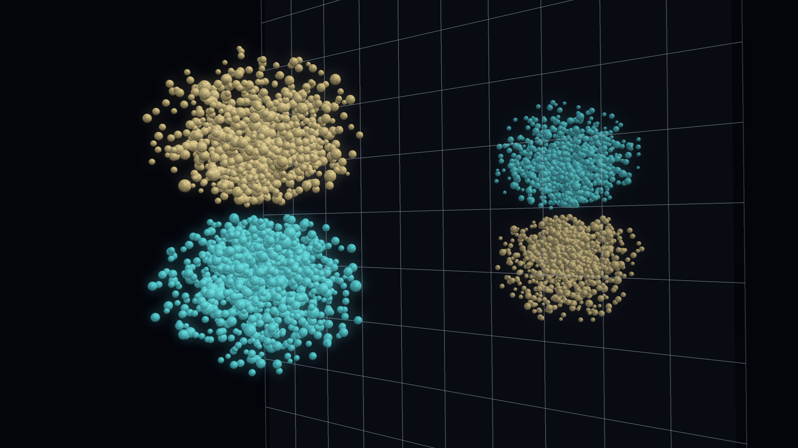
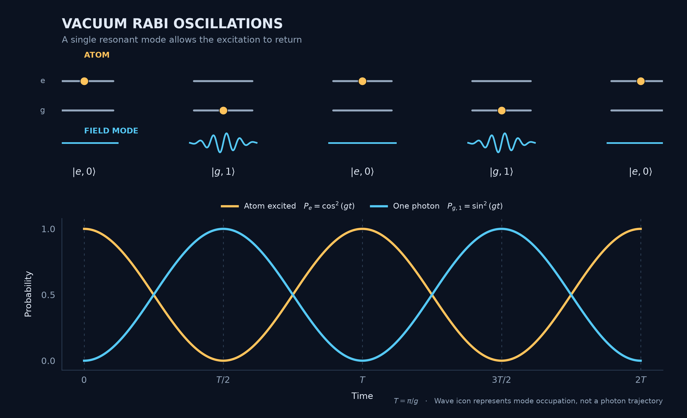
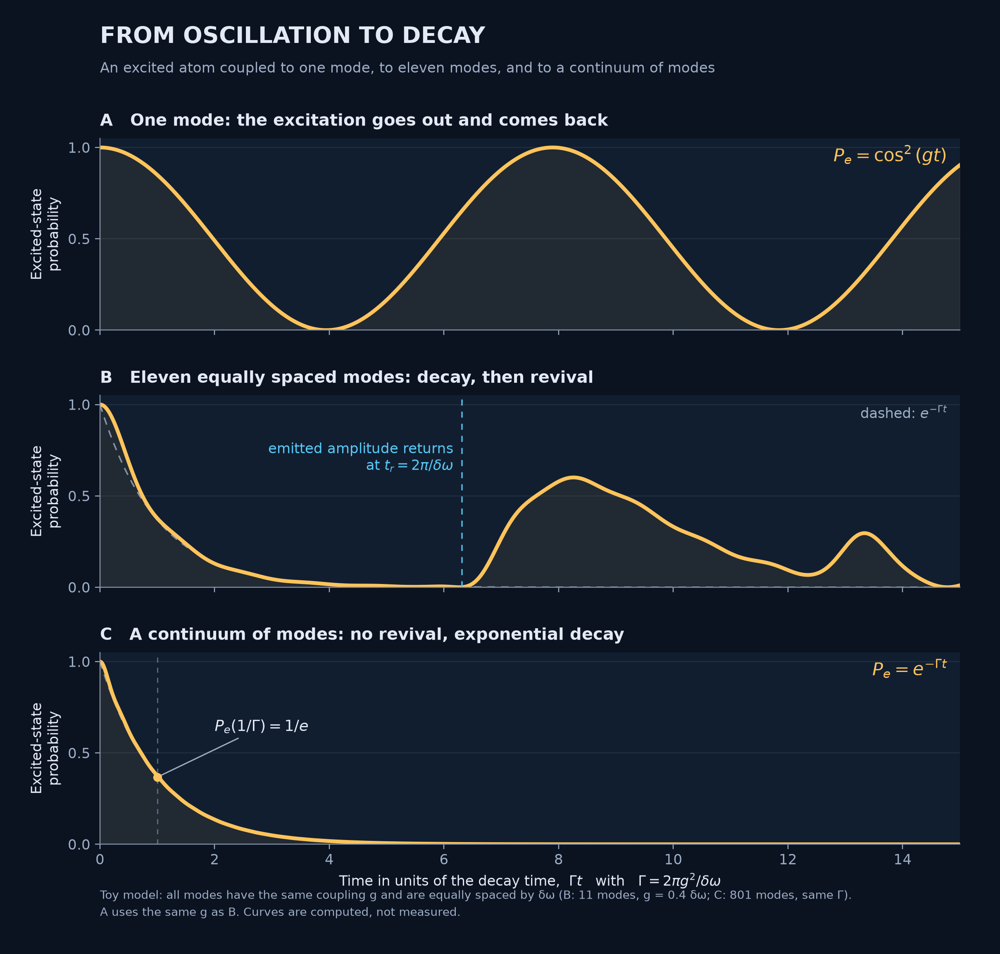
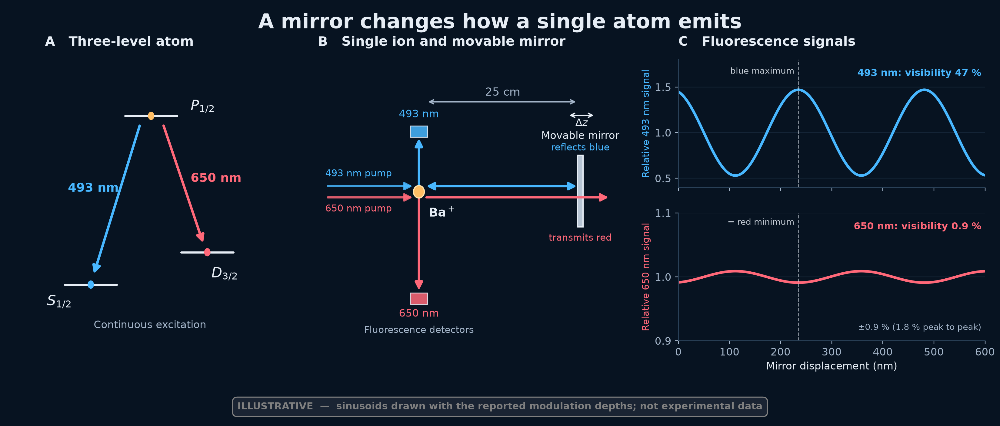
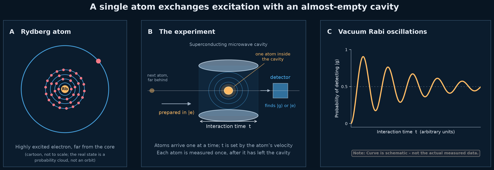

# An Atom's Lifetime Is Not Its Own
## A mirror or a cavity can speed up an atom's decay, slow it down, or bring the excitation back.

<!--
Atomic Radiation — Post 2
Status: PROSE DRAFT SKELETON

Publication metadata (draft):

date: 2026-11-05
revision: 1

medium:
  topics:
    - Quantum Physics
    - Physics
    - Quantum Mechanics
    - Atomic Physics
    - Science
  seo_title: "An Atom's Lifetime Is Not Its Own"
  seo_description: "Why does an excited atom emit light? Discover how electromagnetic modes, mirrors and cavities change spontaneous emission—and can even bring the excitation back."
  preview_title: "An Atom's Lifetime Is Not Its Own"
  preview_subtitle: "How mirrors and cavities change spontaneous emission"
  publication: ""
  canonical_url: ""

wordpress:
  excerpt: "An excited atom seems to have a fixed lifetime. But a mirror can change it, and a cavity can even return the excitation. The quantum field explains why."
-->

> Caption: **A hydrogen 2p orbital in front of a mirror. The two colours show opposite signs of the wavefunction. The reflected colours are reversed to illustrate the opposite orientation of the electromagnetic image dipole for a transition dipole parallel to the mirror.**
> Alt text: A three-dimensional electron cloud made of many glowing amber and cyan spheres on a black background. The upper lobe is amber and the lower lobe cyan. Beyond a faint mirror plane, a smaller, dimmer reflection shows the colours reversed.
> Source: Visualization by author.

Imagine preparing 100 identical atoms in the same excited state. You cannot predict when any particular atom will decay to ground state. But you can predict what happens to the group. After one atomic lifetime, about 37 atoms will still be excited. After two lifetimes, only 14 remain. The number falls exponentially, even though each individual emission happens at an unpredictable moment.

In the previous article, *Why Do Atoms Radiate?*, we found that the lifetime is closely related to the atom's internal structure. A transition with a strong electric dipole emits light quickly, while a weaker transition takes longer. For an atom in free space, the decay rate is

$$
\Gamma = \frac{1}{\tau} = \frac{\omega_0^3 d^2}{3\pi\varepsilon_0\hbar c^3}
$$

The frequency *ω₀* and the transition dipole *d = |⟨g|d̂|e⟩|* are properties of the atom. Here *d* is the transition matrix element, as in the previous article, not the amplitude of an arbitrary classical oscillating dipole. The remaining quantities are constants of nature. Nothing in this expression seems to depend on the atom's surroundings. 

> **It is tempting to conclude that the spontaneoud emission lifetime belongs to the atom itself.**

In the previous article, we treated the electromagnetic field classically, as a wave that can carry away any amount of energy. Now we will treat the field quantum mechanically, with its own modes, each capable of exchanging energy with the atom in discrete amounts.

This changes how we understand spontaneous emission. We will find that an atom interacting with a single field mode can give up its excitation and take it back. When it interacts with a continuum of modes, that exchange becomes effectively irreversible, producing the familiar exponential decay. And by changing the electromagnetic environment, with a mirror or a cavity, we can change the atom's lifetime or even recover the reversible exchange.

The lifetime, it turns out, is not determined by the atom alone. To understand it, we must consider the atom and the electromagnetic field together.

## Giving the Atom a Quantized Field to Talk To

We start with a two-level atom, with ground state *|g⟩* and excited state *|e⟩*, separated by energy *ℏω₀*. Each electromagnetic field mode is a quantum harmonic oscillator with energy levels separated by *ℏω*. Its excitations are photons, created and removed by the operators *a†* and *a*.

Even with no photons, the field has zero mean, *⟨E⟩ = 0*, but a nonzero uncertainty. The characteristic electric-field amplitude of an empty mode is

$$
\mathcal{E}_0=\sqrt{\frac{\hbar\omega}{2\varepsilon_0 V}}
$$

where *V* is the mode volume. A smaller volume means a stronger field per photon.

The interaction energy is minus the scalar product of the atomic dipole moment and the electric field:

$$
H_{\mathrm{int}}=-\mathbf{d}\cdot\mathbf{E}
$$

Both the dipole and the field are now quantum operators. The dipole changes the atomic state, while the field operators create or remove photons.

We assume the atom is much smaller than the wavelength, consider only two atomic levels and one resonant field mode, and neglect rapidly oscillating, off-resonant terms. This last simplification is the *rotating-wave approximation*: we retain processes that exchange an excitation between atom and field, but discard terms that simultaneously create or remove excitations in both.

The resulting interaction is the Jaynes–Cummings Hamiltonian [1]:

$$
H_{\mathrm{int}}=\hbar g\left(\sigma_+a+\sigma_-a^\dagger\right)
$$

Here *σ₊* and *σ₋* raise and lower the atomic state. The first term excites the atom while removing a photon; the second lowers the atom while creating one. The coupling strength is

$$
g=\frac{d\mathcal{E}_0}{\hbar}
=d\sqrt{\frac{\omega}{2\hbar\varepsilon_0 V}}
$$

for a mode aligned with the transition dipole *d*.

An excited atom with an empty field mode starts in *|e, 0⟩*. The interaction couples it to *|g, 1⟩*: the atom in its ground state with one photon in the field. Neither is a stationary state of the coupled system, and the excitation can move between them—even though the field initially contains no photons.

## One Mode: The Excitation Goes Out and Comes Back

An excited atom coupled to a single resonant field mode starts in *|e, 0⟩*. The Jaynes–Cummings interaction couples it to *|g, 1⟩*, and the combined state oscillates between the two. The probabilities are

$$
P_e(t)=\cos^2(gt),\qquad P_{g,1}(t)=\sin^2(gt)
$$

The atom loses its excitation to the field and takes it back, repeatedly (Figure 1). The population oscillates at the *vacuum Rabi frequency*, *Ω₀ = 2g*. No photon was present initially, and no energy is lost from the combined system.

> Caption: **Figure 1. Vacuum Rabi oscillations. An excited atom coupled to a single resonant mode of the field swaps its excitation with the field and takes it back. Top: the joint state alternates between |e,0⟩ (excited atom, no photon) and |g,1⟩ (ground-state atom, one photon). Bottom: the probabilities of the two states, cos²(gt) and sin²(gt). With a single mode the excitation returns; it does not decay.**
> Alt text: Dark-background diagram. Top: five snapshots of a two-level atom and one field mode. A yellow dot sits on the upper level, then the lower level, alternately, while a cyan line alternates between flat and wavelike. Bottom: a yellow cos² curve and a cyan sin² curve oscillating in opposition between zero and one.
> Source: Image by author.

There is a subtle difference from the oscillating dipole in the previous article. Although the atom exchanges energy with the field, its average dipole moment remains zero. The two components of the combined state have different photon numbers, so they cannot interfere to produce an oscillating atomic dipole. At intermediate times, the atom and field become *entangled*: neither can then be described by a pure state of its own. At the moments when the excitation is entirely in the atom or entirely in the field, the joint state is again a product state.

What if the mode already contains *n* photons? The coupling between *|e, n⟩* and *|g, n + 1⟩* increases by a factor *√(n + 1)*, giving a Rabi frequency *Ωₙ = 2g√(n + 1)*. The coupling is an amplitude, so its square scales as *n + 1*. In the weak-coupling, irreversible limit, the transition rate is proportional to *n + 1*: the *n* part is stimulated emission, while the remaining 1 is spontaneous emission into an initially empty mode. This is Einstein's distinction between the two processes.

With one mode, however, there is no fixed decay rate or lifetime. The excitation always returns. To obtain the exponential decay of our 100 atoms, we need more modes.

## Many Modes: The Excitation Does Not Come Back

In free space, an atom interacts with many electromagnetic modes, each with a different frequency and direction. The excitation can enter any of them. Unlike the single-mode case, these contributions evolve at different frequencies and gradually fall out of phase. The probability of finding the atom excited decreases.

Figure 2 shows what happens as we increase the number of modes. With one mode, the excitation oscillates between atom and field. With eleven equally spaced modes, it initially decays, but the modes eventually come back into phase and part of the excitation returns. The recurrence begins around *tᵣ = 2π/δω*, where *δω* is the spacing between modes. In a one-dimensional cavity of length *L*, this corresponds to the light's round-trip time, *2L/c*.

> Caption: **Figure 2. From oscillation to decay. A: one mode, the excitation oscillates between atom and field. B: eleven equally spaced modes, the atom's excitation decays, and the returning amplitude arrives after the time tᵣ = 2π/δω, when the excitation partly comes back. The dashed curve is e⁻Γᵗ; the curve lies slightly below it at the start because eleven modes have a finite bandwidth. C: a continuum of modes, so there is no revival on the timescale shown and the decay is exponential with rate Γ. Time is in units of 1/Γ. Toy model with equal couplings, in the rotating-wave approximation, with at most one excitation, computed numerically.**
> Alt text: Three stacked panels on a dark background, each showing the probability that the atom is excited against time. A: a smooth oscillation between one and zero. B: a fast decay to near zero, then, after a marked time, a partial revival to about 0.6 followed by smaller bumps. C: a smooth exponential decay with the point 1/e marked at t = 1/Γ.
> Source: Image by author.

In free space, the modes form a continuum. Their contributions do not rephase on any relevant timescale, and the excitation does not return. For weak coupling and a sufficiently smooth distribution of modes, the excited-state probability follows the familiar exponential decay, *Pₑ(t) ≈ e⁻Γᵗ*, with

$$
\Gamma=2\pi g^2(\omega_0)\rho(\omega_0)
$$

Here *g* is the coupling strength and *ρ* the density of available modes at the transition frequency *ω₀*. The rate depends on both the atom's coupling to the field and the number of modes into which it can emit.

For the electromagnetic field in free space, accounting for the two polarizations and the direction of the transition dipole reproduces exactly the decay rate from the previous article. The mode volume cancels, and the result contains only *ω₀*, *d*, *ε₀* and *c*. What appeared to be a property of the atom alone is actually the result of its interaction with the free-space electromagnetic field.

The exponential law is an approximation: at very short times the decay begins quadratically, and at extremely long times it also departs from an exponential. But over ordinary atomic lifetimes, it describes the observations remarkably well.

We can now understand our 100 atoms. With one mode, their excited-state population would oscillate. With a continuum, it falls exponentially. And because the rate depends on the available electromagnetic modes, changing those modes should change the lifetime.

## A Mirror Changes the Modes Available to the Atom

The decay rate depends on the modes into which an atom can emit. A mirror changes those modes: the incident and reflected fields interfere, altering the electromagnetic field at the atom's position. The decay rate therefore depends on the distance *z* to the mirror and the orientation of the transition dipole:

$$
\frac{\Gamma(z)}{\Gamma_0}=\frac{\rho(\omega_0,z)}{\rho_0(\omega_0)}
$$

Here *ρ* is the local density of electromagnetic modes, weighted by their coupling to the transition dipole, and *Γ₀* is the free-space decay rate.

In 1970, Karl Drexhage demonstrated this effect by placing fluorescent molecules at different distances from a reflecting surface [2]. Their lifetimes oscillated with distance, with a spacing of approximately half the emitted wavelength and a modulation that weakened farther from the mirror. The atom had not changed, but its lifetime had.

This dependence on the surroundings is not exclusively quantum. A classical oscillating dipole near a mirror also radiates more or less power depending on its position, with the same relative change in emission rate [3].

A particularly striking demonstration came in 2001, when Eschner and colleagues placed a single trapped barium ion about 25 cm from a mirror [4]. The ion emitted blue light at 493 nm and red light at 650 nm. The mirror reflected the blue light but transmitted the red.

The detected blue fluorescence showed strong interference fringes, with 47% visibility. But those fringes alone could have resulted from interference between the direct and reflected light at the detector. The red fluorescence provided the crucial evidence: although it was not reflected, its intensity changed in the opposite direction, by about ±0.9%. Both colours shared the same excited atomic state, so the red signal revealed that the mirror had changed the atom's emission dynamics, not merely the light reaching the detector (Figure 3).

> Caption: **Figure 3. A single atom responds to its own reflection. A: two decay channels of a barium ion from the same excited state. B: a wavelength-selective mirror 25 cm away reflects the blue light and transmits the red. The two fluorescence detectors are above and below the ion. C: the blue signal shows interference fringes (visibility 47%), and the red signal changes in the opposite direction with a visibility of 0.9%. Only the red signal shows that the atom, not just the detected light, is affected. Schematic after Eschner et al. (2001); the curves are illustrative sinusoids drawn with the reported modulation depths, not experimental data.**
> Alt text: Three panels on a dark background. Left: three atomic levels with a blue 493 nm arrow and a red 650 nm arrow leaving the same upper level. Centre: an ion with horizontal blue and red pump beams from the left, a blue double-headed arrow between the ion and a mirror 25 cm away, a red arrow passing straight through the mirror, a blue detector above the ion and a red detector below it. Right: two stacked curves against mirror displacement, a large blue oscillation and a very small red oscillation in opposite phase, with a dashed line joining a blue maximum to a red minimum.
> Source: Image by author, after Eschner et al. (2001).

A mirror can therefore change an atom's lifetime without changing the atom itself. But the excitation still escapes into many field modes. What happens when one mode dominates instead?

## A Cavity Brings the Excitation Back

A mirror changes the decay rate by modifying the available electromagnetic modes. A cavity goes further: it can confine light so that one mode dominates the atom's interaction with the field.

Edward Purcell predicted in 1946 that a resonant cavity could change an atom's spontaneous emission rate [5]. When energy leaks out of the cavity faster than the atom can exchange it with the field, the decay remains irreversible, but its rate depends on the cavity's resonance, volume and losses.

If the coupling *g* becomes much stronger than both the cavity loss rate *κ* and the atom's decay rate into other modes *γ*, the situation changes. The excitation can pass repeatedly between atom and field before escaping. These are the vacuum Rabi oscillations of Figure 1, now in a real, imperfect cavity.

In 1996, Brune and colleagues demonstrated this exchange using highly excited rubidium atoms passing one at a time through a superconducting microwave cavity [6]. The cavity was cooled to about 0.8 K, leaving an average of only 0.06 thermal photons in its resonant mode.

> Caption: **Figure 4. An atom exchanges excitation with an almost empty cavity. A: a Rydberg atom, drawn as a cartoon with one electron far from the core. The real state is a probability cloud, not an orbit. B: atoms prepared in |e⟩ pass one at a time through a superconducting microwave cavity, and their final state is measured after a controlled interaction time. C: the probability of finding the atom in |g⟩ oscillates with decreasing contrast. Schematic after Brune et al. (1996); the curve is illustrative, not measured data.**
> Alt text: Three panels on a dark background. Left: a small core with several rings of electrons close in and one electron on a much larger outer orbit. Centre: a single atom inside a cylindrical cavity, one more atom far to the left, a detector to the right of the cavity, and an arrow marking the interaction time. Right: a smooth curve of detection probability against interaction time that oscillates with decreasing contrast, with a note that it is schematic.
> Source: Image by author, after Brune et al. (1996).

Each atom entered in its excited state. By changing its velocity, the researchers controlled how long it interacted with the cavity. After leaving, each atom was measured once, in either its excited or ground state. Repeating the experiment revealed that the probability of finding the atom in its ground state rose, fell and rose again as the interaction time increased (Figure 4).

Energy exchange between two coupled oscillators is also possible classically. The stronger evidence for field quantization was the photon-number dependence predicted earlier: *Ωₙ = 2g√(n + 1)*. Brune and colleagues observed this dependence, showing that the exchange frequency changes with the number of photons in the cavity.

Return to our 100 excited atoms. In free space, about 37 remain excited after one lifetime. In a strongly coupled cavity, the fraction found excited can fall, rise again and continue oscillating. The atom has not changed. Its electromagnetic environment has.

> **An excited atom's lifetime is not a property of the atom alone, but of the atom and the electromagnetic field together.**

## The Atom's Own Field Is Nowhere in This Picture

In the previous article, we encountered *radiation reaction*: an oscillating dipole emits electromagnetic waves, and its own radiation field acts back on it, draining its energy.

Here, we took a different route. We quantized the electromagnetic field and described how the atom exchanges energy with its modes. From this interaction, we recovered the same spontaneous emission rate, explained why a mirror changes the lifetime, and saw how a cavity can return the excitation.

The atom's lifetime is not determined by the atom alone, but by its interaction with the electromagnetic environment.

Yet something is missing. We have explained spontaneous emission without ever explicitly introducing the atom's own radiation field.

**Where did the atom's own radiation field go?**

Thank you for reading, please leave a comment and do not forget to subscribe.

## References

1. E. T. Jaynes and F. W. Cummings, “Comparison of Quantum and Semiclassical Radiation Theories with Application to the Beam Maser,” *Proceedings of the IEEE* **51**, 89–109 (1963).
2. K. H. Drexhage, “Influence of a Dielectric Interface on Fluorescence Decay Time,” *Journal of Luminescence* **1–2**, 693–701 (1970): [doi.org](https://doi.org/10.1016/0022-2313(70)90081-7).
3. W. L. Barnes, “Fluorescence near Interfaces: The Role of Photonic Mode Density,” *Journal of Modern Optics* **45**, 661–699 (1998).
4. J. Eschner, C. Raab, F. Schmidt-Kaler and R. Blatt, “Light Interference from Single Atoms and Their Mirror Images,” *Nature* **413**, 495–498 (2001): [doi.org](https://doi.org/10.1038/35097017).
5. E. M. Purcell, “Spontaneous Emission Probabilities at Radio Frequencies,” *Physical Review* **69**, 681 (1946).
6. M. Brune, F. Schmidt-Kaler, A. Maali, J. Dreyer, E. Hagley, J. M. Raimond and S. Haroche, “Quantum Rabi Oscillation: A Direct Test of Field Quantization in a Cavity,” *Physical Review Letters* **76**, 1800–1803 (1996): [doi.org](https://doi.org/10.1103/PhysRevLett.76.1800).
