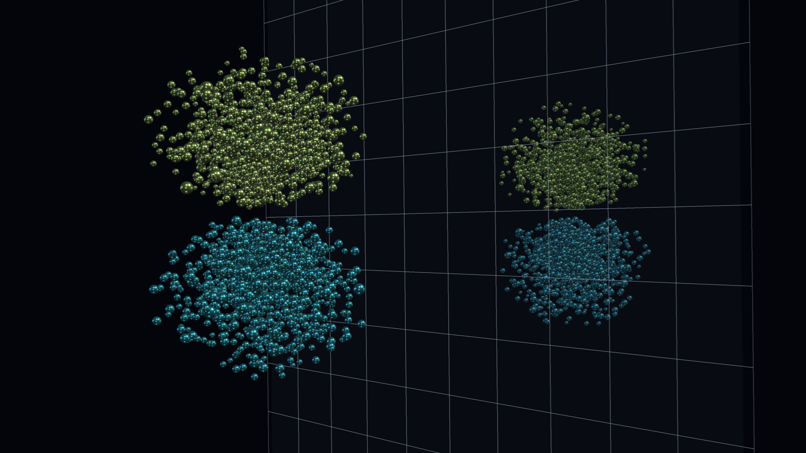
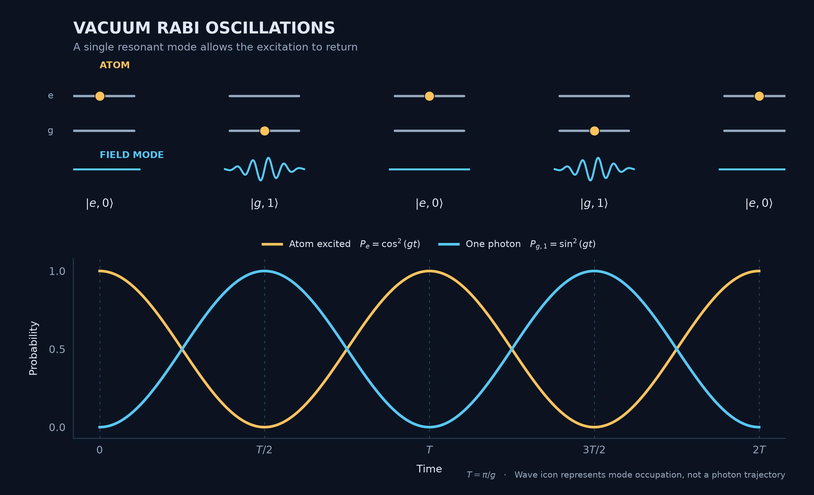
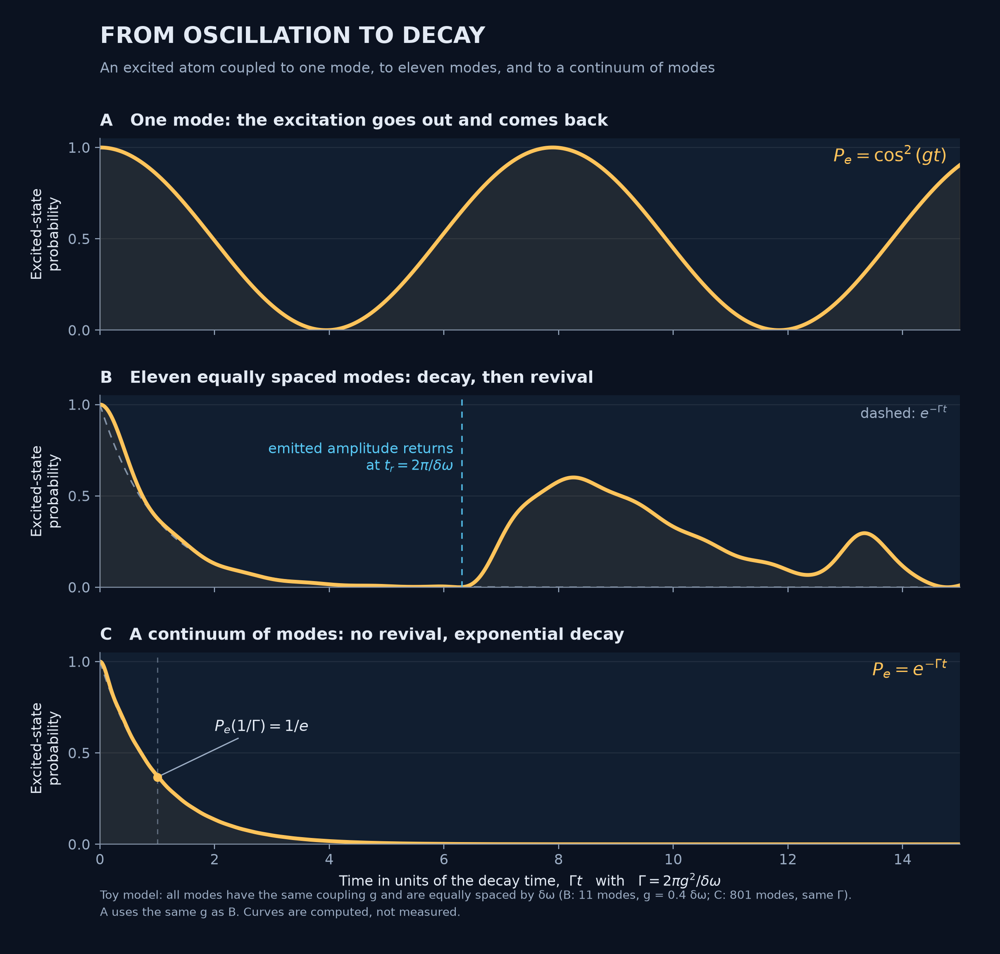
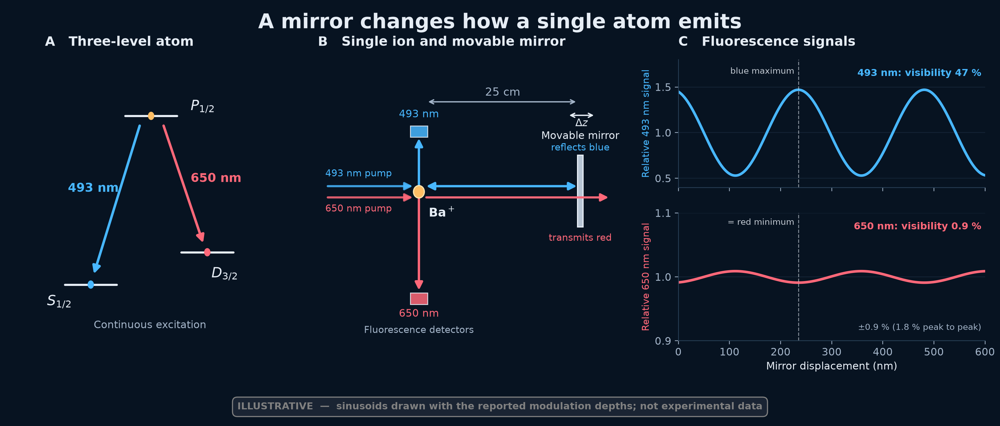
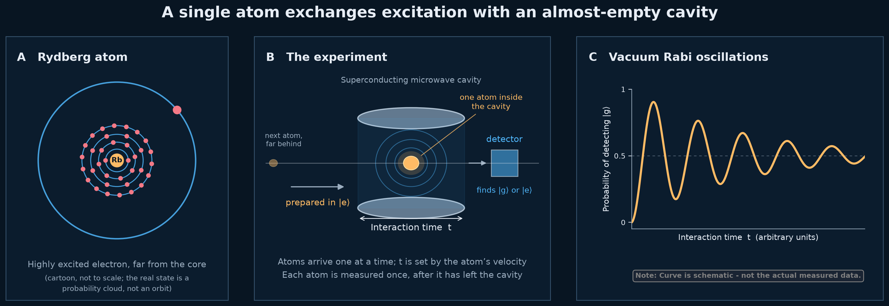

# An Atom's Lifetime Is Not Its Own
## A mirror or a cavity can speed up an atom's decay, slow it down, or bring the excitation back.

> Caption: **A hydrogen 2p orbital in front of a mirror. The two colours show opposite signs of the wavefunction, and the reflection is a purely geometric copy. It stands for the idea of this post: the electromagnetic surroundings of an atom can be changed.**
> Alt text: A three-dimensional electron cloud made of many small spheres on a black background: an upper yellow-green lobe and a lower cyan lobe. To the right, in front of a faint grid plane, a smaller, dimmer copy of both lobes with the same colour order.
> Source: Visualization by author.

<!--
Atomic Radiation — Post 2
Status: OUTLINE v4, FROZEN, 30 October 2026. Next stage: section-by-section drafting.

Decisions made in discussion:
- Central surprise: the lifetime belongs to atom + electromagnetic environment, and with a single mode the excitation can come back.
- We follow the standard quantum-optics route and say that it accounts for the effects. We do NOT say it is the only explanation.
- The JC interaction Hamiltonian is introduced with its assumptions stated explicitly.
- The reflected-field / radiation-reaction picture, Dalibard et al., Milonni–Smith and the "why not absorption" question move to Post 3. Only the closing question points forward.
- Environment dependence is NOT itself quantum: a classical dipole near a mirror shows the same Γ/Γ₀. What the quantized field adds is (1) a trigger without an oscillating dipole, (2) quanta, so one mode can hold and return the excitation, (3) the continuum, which makes the decay irreversible and exponential.
- Cut: Lamb shift, Lorentzian line shape, Nobel Prize paragraph, "Two Ways to Understand the Same Effect", cooperativity in the main text, the computed Γ(z)/Γ₀ plot (mirror section is text only).
- Say "transition dipole", never "overlap": 1s and 2s overlap in space but have zero dipole (Post 1).
- Opening numbers: 37 and 14 atoms (e⁻¹, e⁻²), not 40 and 16.

Equation budget (display math): the recalled Γ in the opening, H_int, P_e(t), Γ = 2πg²ρ, Γ(z)/Γ₀ = ρ(ω₀,z)/ρ₀(ω₀). Everything else is inline unicode, prose, a caption or a note.

Parked, not for the article (perfect plane mirror, x = 4πz/λ; limits checked, plot before any use):
 perpendicular dipole: Γ/Γ₀ = 1 + 3[sin x/x³ − cos x/x²]
 parallel dipole:      Γ/Γ₀ = 1 − (3/2)[sin x/x + cos x/x² − sin x/x³]
 both → 1 at large z; → 2 (perpendicular) and 0 (parallel) as z → 0.
-->

<!-- OPENING (no header) -->

- Start with 100 atoms prepared in the same excited state.
  - After one lifetime τ about 37 are still excited, after 2τ about 14 (e⁻¹ = 0.37, e⁻² = 0.14).
  - Each atom emits at a random moment. Only the average is fixed: N(t) = N₀ e^(−t/τ).
- This τ looks like a property of the atom and of one transition. Post 1 gave the reason: a large transition dipole radiates strongly and decays fast, a small one radiates weakly and lives long. The rate contains only atomic quantities (ω₀, d) plus constants:

  $$
  \Gamma=\frac{1}{\tau}=\frac{\omega_0^{3}\,d^{2}}{3\pi\varepsilon_0\hbar c^{3}}
  $$

- Post 1 treated the field classically: the oscillating dipole radiates into a field that can take any amount of energy.
  - A quantized field takes energy in units of ħω, one oscillator per mode.
  - Plant, without comment: ε₀ and c are the free-space electromagnetic field written as constants. The reader finds this in Sections 3 and 4.
- Say what this post shows, without a recap of Post 1:
  - A mirror changes τ.
  - With the right cavity the excitation goes out and comes back.
- Say that we follow the standard route of quantum optics and that it accounts for both effects. Do not claim it is the only route.

## Giving the Atom a Quantized Field to Talk To

<!-- Working header. -->

- **Need:** Post 1's Γ has no field in it, and the Schrödinger equation of the atom alone has no coupling to light.
- **Atom:** two levels, |g⟩ and |e⟩, with transition frequency ω₀. In prose, not displayed: H_A = (ħω₀/2) σ_z.
- **Field:** each mode is a harmonic oscillator. Photons are its excitations, created and destroyed by a† and a. Refer back to the earlier posts on the oscillator. In prose: H_F = ħω(a†a + ½).
- **Plant, one or two sentences only:** in the state with no photons the electric field has zero mean but a nonzero spread, ⟨E⟩ = 0 and ⟨E²⟩ = ℰ₀² with ℰ₀ = √(ħω/2ε₀V). Do not attribute anything to it yet.
- **The coupling:** the atomic dipole couples to the electric field at the atom, H_int = −**d**·**E**, with **E** ∝ ℰ₀(a + a†) and **d** = d(σ₊ + σ₋).
- **Assumptions, as a short explicit list:**
  - Electric-dipole approximation: the atom is much smaller than the wavelength (Post 1: 0.1 nm against 46 nm).
  - Two levels: one resonant transition, all others far off resonance.
  - One mode first. The continuum comes in Section 3.
  - Rotating-wave approximation (RWA): keep σ₊a and σ₋a†, drop σ₊a† and σ₋a.
  - The field starts with no photons.
- **RWA, one clause:** the dropped terms σ₊a† and σ₋a take |g,n⟩ to |e,n+1⟩ and |e,n⟩ to |g,n−1⟩. They are off resonant, with energy mismatch ħ(ω₀ + ω), but they are not zero. Do not say anything about the ground state here.
- **Result** (Jaynes–Cummings [1]):

  $$
  H_{\mathrm{int}}=\hbar g\,(\sigma_+ a+\sigma_- a^\dagger),\qquad g=\frac{d\,\mathcal{E}_0}{\hbar}=d\sqrt{\frac{\omega}{2\hbar\varepsilon_0 V}}
  $$

- **Bridge:** the atomic eigenstates of Post 1 are no longer eigenstates of the full system. |e,0⟩ is coupled to exactly one other state, |g,1⟩.

<!--
Check: Azem's Eq. (21) writes g without ħ. With H_int = ħg(...) the definition above (g = dℰ₀/ħ) is the consistent one. Azem also has typos (σ₋ = |e⟩⟨g|, and the P₀,₀ expression); do not copy.
Avoid Azem's wording that the "1" in √(n+1) is "triggered by vacuum fluctuations": that is the convention-dependent attribution for Post 3.
-->

## One Mode: The Excitation Goes Out and Comes Back

<!-- Working header. -->

- **State and solution:** the atom plus one resonant mode, starting in |e,0⟩, stays in the two-state subspace, |Ψ(t)⟩ = c_e(t)|e,0⟩ + c_g(t)|g,1⟩, with c_e = cos(gt) and c_g = −i sin(gt):

  $$
  P_e(t)=\cos^{2}(gt),\qquad P_{g,1}(t)=\sin^{2}(gt)
  $$

- The population oscillates at the vacuum Rabi frequency Ω₀ = 2g.
- Energy moves from atom to field and back, with no photon in the field to start with. Nothing is random in this evolution; chance enters only in what a measurement of one atom finds.
- **Post 1 check, the payoff for its open question.** The atom's mean dipole is zero at all times, although it gives up its energy: ⟨σₓ⟩ = c_e* c_g ⟨e|σₓ|g⟩⟨0|1⟩ + c.c. = 0, because ⟨0|1⟩ = 0.
  - Atom and field are entangled, and the atom alone is in a mixed state, not a coherent superposition. Keep "mixed state" and Post 1's "superposition of eigenstates" apart.
- **Photon number:** with n photons already in the mode, |e,n⟩ couples to |g,n+1⟩ with an amplitude that grows as √(n+1), so the Rabi frequency is Ω_n = 2g√(n+1).
  - The probability depends on the square of the amplitude. In the irreversible limit of Section 3 this gives the familiar n+1: stimulated emission (n) plus spontaneous emission (1), which is Einstein's A and B from one coupling.
  - For a single mode there is no constant rate, only oscillation.
  - Ω_n returns in the Brune experiment (Section 5).
- **Figure 1** (vacuum Rabi oscillation).
- **Bridge:** a single mode returns the excitation. An atom in free space never gets it back.

> Caption: **Figure 1. Vacuum Rabi oscillations. An excited atom coupled to a single resonant mode of the field swaps its excitation with the field and takes it back. Top: the joint state alternates between |e,0⟩ (excited atom, no photon) and |g,1⟩ (ground-state atom, one photon). Bottom: the probabilities of the two states, cos²(gt) and sin²(gt). With a single mode the excitation returns; it does not decay.**
> Alt text: Dark-background diagram. Top: five snapshots of a two-level atom and one field mode. A yellow dot sits on the upper level, then the lower level, alternately, while a cyan line alternates between flat and wavelike. Bottom: a yellow cos² curve and a cyan sin² curve oscillating in opposition between zero and one.
> Source: Image by author.

## Many Modes: The Excitation Does Not Come Back

<!-- Working header. This is the central transition. -->

- **State:** the excitation can go into any mode k: |Ψ⟩ = c_e|e,0⟩ + Σ_k c_k|g,1_k⟩.
- **Toy model, labelled as such:** N equally spaced modes with equal couplings, chosen only to show rephasing. RWA, single excitation, solved exactly (Figure 2).
  - The atom's amplitude decays as the modes dephase. The returning amplitude arrives at t_r = 2π/δω, and the revival sets in there and peaks a little later. It is not a peak exactly at t_r. Checked numerically for N = 11, g = 0.4 δω.
  - For a cavity of length L, δω = πc/L, so t_r = 2L/c, the round-trip time of light.
  - Real mode sets need not behave like this. When g ≪ δω the resonant mode dominates and the result is Rabi-like oscillation, not a clean revival. The claim is only that in the standard free-space continuum with weak coupling, no recurrence occurs on any relevant time.
- **Continuum limit:** δω → 0 and t_r → ∞. Under weak coupling and a mode density that is smooth over the linewidth, the decay is exponential, P_e(t) ≃ e^(−Γt), with

  $$
  \Gamma=2\pi\,g^{2}(\omega_0)\,\rho(\omega_0)
  $$

  where ρ(ω) is the number of modes per unit angular frequency. Γ is a coupling times a mode density: it counts how many modes are available at ω₀.
- **Free space:** state the result, keep the derivation in the notes. Averaging the projection of **d** onto the two transverse polarizations over directions gives a factor 1/3, and V cancels between g² and ρ. This recovers Post 1's Γ.
  - Say it plainly: ε₀ and c are the free-space mode density.
  - Antenna formula and quantum calculation give the same Γ. The quantum one does not need an oscillating dipole.
- **Back to the 100 atoms:** the random emission time and the irreversibility come from the continuum. A single mode gives oscillation, many modes give decay.
- **Conditions, one clause each:**
  - weak coupling;
  - mode density smooth over the linewidth (Markov, Weisskopf–Wigner);
  - the exponential fails at very short times (quadratic start, visible in Figure 2B) and very long times (power law).
- The linewidth is Γ/2π in hertz (Post 1: 100 MHz for 2p). Say nothing more about line shapes.
- **Figure 2** (oscillation, revival, decay).
- **Bridge:** if Γ counts modes, changing the modes changes Γ.

<!--
Derivation for the notes (not for the article).
Per mode, for a dipole along the polarization: g² = d²ω/(2ħε₀V).
Total mode density, both polarizations: ρ = Vω²/(π²c³).
Orientation average of the projection: 1/3.
Γ = (1/3) · 2π · [d²ω₀/(2ħε₀V)] · [Vω₀²/(π²c³)] = ω₀³d²/(3πε₀ħc³).
Figure 2 diagnostics: Γ = 2πg²/δω; Γt_r = 6.3 for g = 0.4 δω; P_e(Γt = 1) = 0.377 (1/e = 0.368) for B; panel C (801 modes) deviates from e^(−Γt) by at most 0.04 and has its first recurrence at Γt ≈ 126, beyond the axis.
-->

> Caption: **Figure 2. From oscillation to decay. A: one mode, the excitation oscillates between atom and field. B: eleven equally spaced modes, the atom's excitation decays, and the returning amplitude arrives after the time t_r = 2π/δω, when the excitation partly comes back. The dashed curve is e^(−Γt); the curve lies slightly below it at the start, because eleven modes have a finite bandwidth. C: a continuum of modes, so there is no revival and the decay is exponential with rate Γ. Time is in units of 1/Γ. Toy model with equal couplings, in the rotating-wave approximation, with at most one excitation, computed exactly.**
> Alt text: Three stacked panels on a dark background, each showing the probability that the atom is excited against time. A: a smooth oscillation between one and zero. B: a fast decay to near zero, then, after a marked time, a partial revival to about 0.6 followed by smaller bumps. C: a smooth exponential decay with the point 1/e marked at t = 1/Γ.
> Source: Image by author.

## A Mirror Changes the Modes Available to the Atom

<!-- Working header. -->

- A mirror adds reflected modes. At the atom's position the mode density becomes ρ(ω₀, z), where z is the distance to the mirror.
- **One equation:** the rate follows the local, orientation-resolved mode density:

  $$
  \frac{\Gamma(z)}{\Gamma_0}=\frac{\rho(\omega_0,z)}{\rho_0(\omega_0)}
  $$

- **Classical parallel, one plain sentence:** a classical dipole in front of a mirror radiates a different power by the same ratio [3]. The environment dependence is not itself quantum. Without this sentence the section implies a quantum effect it does not have.
- **Drexhage (1970) [2]:** fluorescent molecules at controlled distances from a mirror, lifetimes oscillating with distance. This is the direct lifetime measurement, so give it the weight.
  - Wording: oscillations with a spacing of λ/2 and an amplitude that falls off with distance, not an exact period.
  - Geometry: this is the near-field plane-mirror case. No plot in the article; the formulas are parked in the status comment.
- **Eschner (2001) [4], kept short, one paragraph:**
  - A single Ba⁺ ion, mirror about 25 cm away. The mirror covers a small solid angle, so the near-field plane-mirror picture of Drexhage does not carry over. Check in the paper how the effect scales with the collected solid angle.
  - Blue (493 nm) light is reflected and gives interference fringes at the detector. Fringes alone would not show that the atom changed.
  - The red (650 nm) light is not reflected and measures the population of the shared excited state. It changes in step, with opposite sign: the atom itself responds.
  - The red modulation is small. Reported visibilities: 47% (blue) and 0.9% (red). Visibility 0.9% means ±0.9% about the mean, which is 1.8% peak to peak. Say which.
- **Figure 3** (Eschner).
- **Bridge:** a mirror changes the rate, but the atom still decays into a continuum. What if one mode dominates?

> Caption: **Figure 3. A single atom responds to its own reflection. A: two decay channels of a barium ion from the same excited state. B: a wavelength-selective mirror 25 cm away reflects the blue light and transmits the red. The two fluorescence detectors are above and below the ion. C: the blue signal shows interference fringes (visibility 47%), and the red signal changes in the opposite direction with a visibility of 0.9%, drawn here on a 0.9–1.1 scale so that its size can be compared with the blue. Only the red signal shows that the atom, not just the detected light, is affected. Schematic after Eschner et al. (2001); the curves are illustrative sinusoids drawn with the reported modulation depths, not experimental data.**
> Alt text: Three panels on a dark background. Left: three atomic levels with a blue 493 nm arrow and a red 650 nm arrow leaving the same upper level. Centre: an ion with horizontal blue and red pump beams from the left, a blue double-headed arrow between the ion and a mirror 25 cm away, a red arrow passing straight through the mirror, a blue detector above the ion and a red detector below it. Right: two stacked curves against mirror displacement, a large blue oscillation and a very small red oscillation in opposite phase, with a dashed line joining a blue maximum to a red minimum.
> Source: Image by author, after Eschner et al. (2001).

## A Cavity Brings the Excitation Back

<!-- Working header. -->

- **Purcell (1946) [5], one paragraph:** weak coupling (g ≪ κ, γ). For an atom resonant with the mode, at a field maximum, with its dipole along the field, the cavity changes the decay rate. The decay stays irreversible. No formula in the main text.
- **Strong coupling:** one mode dominates and the atom–mode coupling beats both losses: g ≫ κ, γ. Here κ = ω/Q is the cavity photon loss rate and γ the decay into other modes.
  - This is Section 2 realized: the oscillation of Figure 1 is now observable, damped by κ and γ.
  - Cooperativity C = g²/(κγ) goes in an optional technical note.
- **Brune et al. (1996) [6], tightened:**
  - Rydberg rubidium atoms, one at a time through a superconducting microwave cavity. Verify: transition near 51 GHz, cavity at 0.8 K, mean thermal photon number about 0.06.
  - Interaction time set by the atomic velocity.
  - Each atom is measured once, after leaving the cavity. The oscillation is built up statistically from many atoms.
  - The probability of finding g rises, falls, rises again, with decreasing contrast.
- **What makes it quantum:**
  - Coupled classical oscillators also swap energy.
  - The test is the photon-number dependence Ω_n = 2g√(n+1) from Section 2: different photon-number components give distinct frequencies, and this was observed.
- **Tie to the opening:** send 100 excited atoms through for different times and the number found excited oscillates. It does not decay.
- **Figure 4** (Brune).

> Caption: **Figure 4. An atom exchanges excitation with an almost empty cavity. A: a Rydberg atom, drawn as a cartoon with one electron far from the core. The real state is a probability cloud, not an orbit. B: atoms prepared in |e⟩ pass one at a time through a superconducting microwave cavity, and their final state is measured after a controlled interaction time. C: the probability of finding the atom in |g⟩ oscillates and loses contrast as energy leaks out of the cavity. Schematic after Brune et al. (1996); the curve is a schematic theory curve, not measured data.**
> Alt text: Three panels on a dark background. Left: a small core with several rings of electrons close in and one electron on a much larger outer orbit. Centre: a single atom inside a cylindrical cavity, one more atom far to the left, a detector to the right of the cavity, and an arrow marking the interaction time. Right: a smooth curve of detection probability against interaction time that oscillates with decreasing contrast, with a note that it is schematic.
> Source: Image by author, after Brune et al. (1996).

## The Atom's Own Field Is Nowhere in This Picture

<!-- Working closing header. -->

- **Contrast, stated plainly, no recap:**
  - In Post 1 the atom's own field acted back on it, a classical radiation reaction.
  - In this post that field never appeared. A mode density and a field with no photons were enough to explain the rate, the mirror and the cavity.
- **Last sentence, as a question, not answered here:** where did the atom's own radiation field go?
  - The honest answer, that it is inside c_e(t) and ρ and was never removed, belongs to Post 3.
  - Do not mention vacuum fluctuations as noise, operator ordering or the ground state.
- Optional pull quote, in bold: **The lifetime of an excited atom belongs to the atom and its surroundings together.**

---

## References

1. Jaynes, E. T., & Cummings, F. W. (1963). “Comparison of Quantum and Semiclassical Radiation Theories with Application to the Beam Maser.” *Proceedings of the IEEE*, **51**, 89–109.
2. Drexhage, K. H. (1970). “Influence of a Dielectric Interface on Fluorescence Decay Time.” *Journal of Luminescence*, **1–2**, 693–701. https://doi.org/10.1016/0022-2313(70)90081-7
3. Barnes, W. L. (1998). “Fluorescence near Interfaces: The Role of Photonic Mode Density.” *Journal of Modern Optics*, **45**, 661–699. [verify title and pages]
4. Eschner, J., Raab, C., Schmidt-Kaler, F., & Blatt, R. (2001). “Light Interference from Single Atoms and Their Mirror Images.” *Nature*, **413**, 495–498. https://doi.org/10.1038/35097017
5. Purcell, E. M. (1946). “Spontaneous Emission Probabilities at Radio Frequencies.” *Physical Review*, **69**, 681.
6. Brune, M., Schmidt-Kaler, F., Maali, A., Dreyer, J., Hagley, E., Raimond, J. M., & Haroche, S. (1996). “Quantum Rabi Oscillation: A Direct Test of Field Quantization in a Cavity.” *Physical Review Letters*, **76**, 1800–1803. https://doi.org/10.1103/PhysRevLett.76.1800

<!--
FIGURE INVENTORY (final)
- Feature image: hydrogen 2p and mirror. Visual metaphor, geometric reflection only.
- Figure 1: vacuum Rabi oscillation (Section 2).
- Figure 2: one mode, eleven modes with revival, continuum with exponential decay. Computed.
- Figure 3: Eschner. Illustrative sinusoids with the reported visibilities, not data.
- Figure 4: Brune. Bohr-style cartoon in A (deliberately non-physical, labelled), schematic theory curve in C, not data.

TO VERIFY BEFORE THE AFFECTED SECTION IS DRAFTED
- g definition with ħ (see the comment in Section 1).
- Brune: transition near 51 GHz, cavity at 0.8 K, mean thermal photon number about 0.06.
- Eschner: the 47% and 0.9% visibilities were found in the Eschner-group ICOLS'01 proceedings (Fig. 5 caption). Confirm in the Nature paper before printing. Check how the effect scales with the collected solid angle. If a feedback-delay argument is used, the round trip is 2 × 0.25 m / c ≈ 1.7 ns against the P₁/₂ lifetime (verify, about 8 ns).
- Drexhage: experimental details (dielectric spacer geometry).
- Barnes: title, volume, pages.
- Purcell: if a formula is ever added, the factor (2C or 4C) depends on how κ is defined.

EDITORIAL NOTES — NOT ARTICLE HEADINGS
- Figures 3 and 4 show illustrative curves. Do not describe them as measured points. Reassess reproduction rights if replacing them with data extracted from the published figures.
- Eschner's 650 nm signal is an indirect probe of the shared excited-state population, not a direct lifetime measurement.
- Brune's cavity was nearly empty, not exactly in the vacuum state. The photon-number dependence is a stronger quantization test than the oscillation alone.
- Avoid describing the cavity process as a literal photon bouncing between the mirrors and repeatedly striking the atom. It is coherent exchange between an atom and a cavity mode.
- The Rydberg cartoon in Figure 4A contradicts Post 1's "no orbit" on purpose. Its note in the figure says so; keep that note in the caption.
- The post ends with the question. Do not resolve it here.
-->