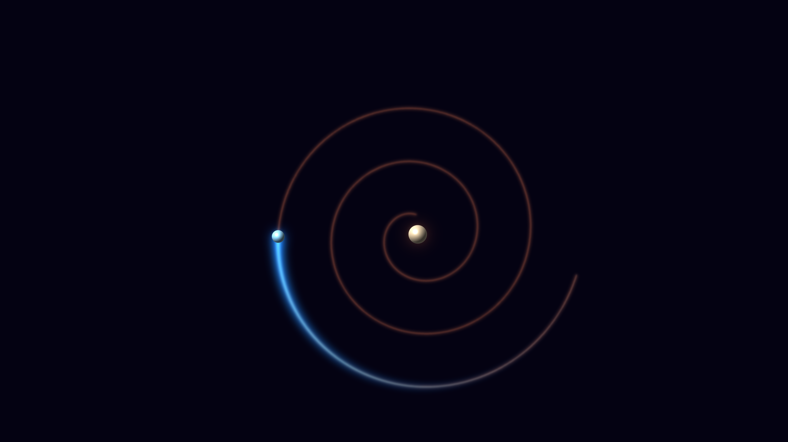
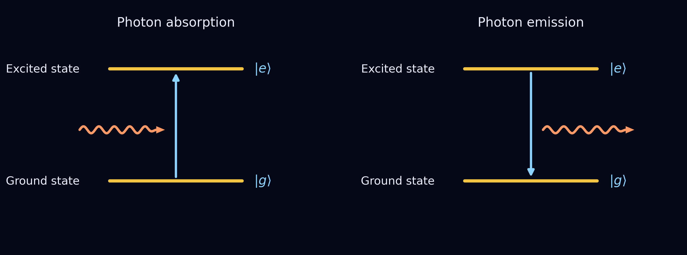
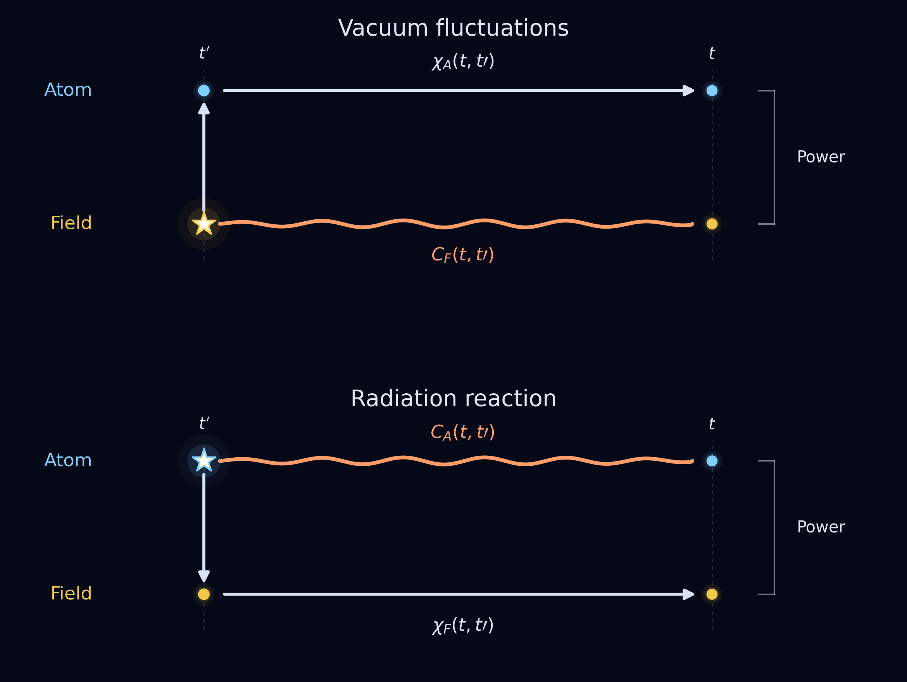
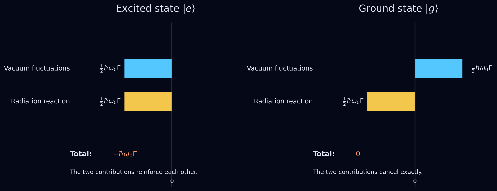

# Spontaneous Emission Revisited

## A Closer Look at What Causes Spontaneous Emission Reveals a Careful Balance, and Restores the Role of an Atom's Own Radiation Field

> Caption: **The classical picture. An orbiting electron radiates, loses energy and spirals into the nucleus. The bright arc marks the recent path, the fading line the earlier path.**
> Alt text: A glowing blue electron spiralling inward toward a pale nucleus on a dark background, with a bright arc for its recent path and a fainter spiral for its earlier path.
> Source: Image by author.

You might think that everything about spontaneous emission of light by excited atoms has been said by now. Quantum mechanics predicts the rate of spontaneous emission, and experiments show that we can speed it up, slow it down, or temporarily reverse the exchange of energy by changing the atom's electromagnetic environment.

However, things may not be as simple as they seem. Consider what actually causes an atom to emit a photon: The familiar explanation points to fluctuations of the electromagnetic field, present even in the vacuum. Yet long before quantum mechanics, physicists had identified another mechanism: the force that acts back on the charge from the radiation it produces.

So which is responsible for spontaneous emission: the fluctuations of empty space, or the atom's own radiation field?

As it turns out, the answer involves both — and a remarkable balance between them.

## The Classical Atom Should Collapse

Imagine an electron orbiting an atomic nucleus, much like a planet orbiting the Sun. This was one of the earliest pictures of the atom, but it came with a serious problem.

According to Maxwell's equations, an accelerating electric charge emits electromagnetic radiation. An electron orbiting an atomic nucleus is continuously accelerating, and therefore radiating energy.

That energy has to come from somewhere. As the electron loses energy, its orbit shrinks, causing it to spiral inward until it eventually collapses into the nucleus. Classical electrodynamics seemed to predict that atoms should be unstable.

Physicists had already studied the mechanism behind this energy loss. An accelerating electron generates an electromagnetic field, and that field acts back on the electron itself, producing a force known as radiation reaction, or the self-force. The resulting loss of energy is called radiative damping.

The details of this self-force proved surprisingly difficult to calculate, leading to the work of Abraham, Lorentz, and later Dirac. But the basic prediction was clear: an electron orbiting a nucleus should continuously lose energy.

Yet ordinary atoms are stable. Something fundamental was missing from the classical picture.

## Quantum Mechanics Introduces Stable Atomic States

Quantum mechanics introduced energy eigenstates: stationary probability distributions with well-defined energies. The electron no longer circles the nucleus, and the classical argument for its inevitable collapse no longer applies. In an isolated atom, these energy eigenstates are stable. An excited electron would remain excited indefinitely.

Now introduce an external electromagnetic field.

The electric field interacts with the electron and can drive transitions between energy levels. In a two-level atom, the field can create a superposition of the ground and excited states. Unlike an individual energy eigenstate, such a superposition can have an oscillating electric dipole moment. Depending on the phase relationship between the electric field and the motion of the dipole, energy can flow into the atom or out of it. These are stimulated absorption and stimulated emission, respectively.

Quantum mechanics also explains why some transitions are stronger than others. The shapes of the atomic wavefunctions determine the transition dipole moment, which controls how strongly the atom couples to the electric field.

Thi semiclassical description explains a remarkable amount of atomic physics, but one question remains unanswered.

> **What happens to an excited atom when there is no external electromagnetic field?**

In the semiclassical picture, the excited atom in vacuum would remain excited forever. Yet, we know that excited atoms spontaneously emit light, even when completely isolated.

## Quantizing the Field Seems to Solve Everything

The next step is to also treat the electromagnetic field quantum mechanically. A particularly simple description is the *Jaynes–Cummings* model, which considers a two-level atom interacting with a single quantized field mode. To arrive at this model, we make several simplifying assumptions: 
- we restrict the atom to its ground and excited states, 
- we consider only one field mode, 
- we neglect rapidly oscillating terms in the interaction (the *rotating-wave approximation*, or RWA)

The resulting Hamiltonian couples pairs of states such as

$$
|g,n\rangle \longleftrightarrow |e,n-1\rangle
\qquad\text{or equivalently}\qquad
|e,n\rangle \longleftrightarrow |g,n+1\rangle .
$$

where (*n*) is the number of photons initially present in the field.

> Caption: **Figure 1. Absorption (left) and emission (right) of a photon by a two-level atom with ground state |g⟩ and excited state |e⟩.**
> Alt text: Two energy-level diagrams on a dark background. Left: a wavy arrow represents an incoming photon, while an upward arrow connects the ground state |g⟩ to the excited state |e⟩. Right: a downward arrow connects |e⟩ to |g⟩ while a wavy arrow represents an outgoing photon.
> Source: Image by author.

An excited atom can lose its excitation while the field gains a photon. Conversely, the atom can absorb a photon and move from its ground state to its excited state. The transition probability from excited to ground state is proportional to (*n*+1) (for a fixed short interaction time in the weak-coupling limit). The term proportional to (*n*) describes stimulated emission: photons already present in the field enhance the probability of emitting another one. The additional (1) described the emission of a photon to the vacuum state: Spontaneous emission.

$$
\boxed{|e,0\rangle \longleftrightarrow |g,1\rangle}
$$

The process where an atom in the ground state becomes excited while simultaneously creating a photon (spontaneous absorption), is absent from the Jaynes–Cummings Hamiltonian. We lost this effect early on, when we applied used rotating-wave approximation.

So, the Jaynes–Cummings model gives us the interaction between the atom and the field, even when the field is in the vacuum state. If we extend the model to include a large number of modes we get to irreversible spontaneous emission.  

The usual explanation is that vacuum fluctuations trigger spontaneous emission. But, by pointing to these fluctuations as the trigger for spontaneous emission something rather important has disappeared.

## But Where Did the Atom's Own Radiation Field Go?

We started this post with a classical electron losing energy because of its own radiation field. Now we have a quantum-mechanical atom emitting photons because it interacts with the fluctuations of the vacuum.

What happened to the effect of the electrons radiation field in quantum mechanics?

In fact, the physical interpretation of the quantum description of spontaneous emission has been debated since the early days. There are two extreme views. In one, the atom interacts with the fluctuations of the electromagnetic vacuum. In the other, the atom interacts with the field it generates itself, much as a classical radiating charge experiences radiation reaction. Both approaches reproduce the observed effects, but differ in their physical interpretation.

The difficulty lies in a subtle feature of quantum mechanics: the quantities describing the atom and the electromagnetic field are operators, and the order in which operators are multiplied can matter. Different choices of operator ordering can lead to different divisions between vacuum fluctuations and radiation reaction, even when they agree on the total energy lost by the atom.

Was the distinction between the two mechanisms merely a mathematical convention?

In the early 1980s, Jean Dalibard, Jacques Dupont-Roc and Claude Cohen-Tannoudji  proposed a particularly natural way of separating the two contributions, based on a fundamental requirement: each contribution should be a physical observable, represented by a Hermitian operator.

To understand how that works, we first need to explore a more familiar idea: how an earlier random event can influence what happens later.

## Intermezzo: Events and Effects

Imagine walking down a street on a rainy day. Some people carry open umbrellas, others do not. Rain and open umbrellas are clearly related, but the connection is more interesting than it first appears. Suppose it rained five minutes ago. Two things are likely: it may still be raining, and people who opened their umbrellas may still be carrying them.

An event in the past therefore influences two things in the present. This involves two distinct ideas:

- **Correlation:** How strongly is the rain now related to the rain five minutes ago?
- **Susceptibility:** How strongly do people respond to rain, and how long does that response persist?

Because both the rain and the umbrellas depend on the same earlier event, they are not independent. The probability of finding rain and an open umbrella together is not simply the product of their individual probabilities.

And five minutes ago is not special. The present reflects the combined influence of many earlier events.

### Path 1: The Field Fluctuates, the Atom Responds

Consider the electromagnetic field and an atomic dipole. The instantaneous power transferred to the atomic dipole is *E(t)ḋ(t)*, with *t* the present time. For a vacuum field and an atom in an energy eigenstate without a permanent dipole moment, both *E* and *d* have zero average values. Without correlations between the field and dipole motion, the average ⟨*E(t)ḋ(t)*⟩ would therefore vanish.

An earlier field fluctuation at time *t′* affects what the field is likely to do at *t*, described by the field correlation function *Cꜰ(t, t′)*. It also drives a response in the atom, described by its susceptibility *χₐ(t, t′)*.

The two effects share a common origin. Consequently, the present electric field and atomic dipole motion can be correlated, allowing a nonzero average transfer of energy.

$$
\left\langle\dot H_A(t)\right\rangle_{\mathrm{vf}}
\propto
\int_{t_0}^{t}dt'\,
C_F(t,t')\,
\frac{\partial}{\partial t}\chi_A(t,t')
$$

The correlation describes the field's memory; the susceptibility describes the atom's response.

### Path 2: The Atom Fluctuates, the Field Responds

Now reverse the roles.

An atomic dipole fluctuation at *t′* remains correlated with the dipole at time *t*, described by *Cₐ(t, t′)*. That same fluctuation generates an electromagnetic field. The field's response is described by *χꜰ(t, t′)*.

The atom therefore encounters a field generated by its own earlier fluctuations. This is **radiation reaction**, expressed in quantum-mechanical terms.

Its contribution to the atomic energy-transfer rate is

$$
\left\langle\dot H_A(t)\right\rangle_{\mathrm{rr}}
\propto
\int_{t_0}^{t}dt'\,
\chi_F(t,t')\,
\frac{\partial}{\partial t}C_A(t,t')
$$

The two expressions have the same structure, with the atom and field exchanging roles.

> Caption: **Figure 2. Two histories contributing to atomic energy transfer.** An earlier field fluctuation (top) or atomic fluctuation (bottom), marked by a star, produces both a correlation (wavy line) and a response (straight arrows). Together they contribute to the power transferred to the atom.
> Alt text: Two stacked diagrams showing atom and field at times t′ and t. In the upper panel, a field fluctuation drives an atomic response while remaining correlated with the later field. In the lower panel, an atomic fluctuation drives a field response while remaining correlated with the later atom.
> Source: Image by author.

There is one important qualification. Rain and umbrellas are classical; quantum correlations cannot generally be interpreted as ordinary probabilities. In quantum mechanics, the correlation functions involve symmetrized products of operators, while susceptibilities involve their commutators.

But the underlying distinction survives: **one system fluctuates, the other responds, and their shared history determines the average energy transfer.**

## Two Contributions, One Physical Result

We now have two contributions to the atomic energy-transfer rate: vacuum fluctuations and radiation reaction. But can we really separate them?

The electromagnetic field can be written as the sum of two parts: the *free field*, which exists independently of the atom, and the *source field*, generated by the atom itself.

In quantum mechanics, however, these fields are operators. Although the complete field commutes with atomic observables at equal times, its free and source parts generally do not. Consequently, the energy-transfer rate can be divided between vacuum fluctuations and radiation reaction in different ways, depending on the order in which the operators are multiplied.

The total result remains unchanged, but the individual contributions depend on this *operator ordering*.

Dalibard, Dupont-Roc and Cohen-Tannoudji proposed a natural choice. Since the total atomic energy-transfer rate is represented by a Hermitian operator, they required both contributions to be Hermitian separately. Together with symmetry considerations, this leads to *symmetric operator ordering*.

The resulting expressions are precisely the correlation–response terms introduced above. And they reveal a remarkable difference between an excited atom and one in its ground state.

For a two-level atom, the atomic susceptibility *χₐ* changes sign between the excited state |*e*⟩ and the ground state |*g*⟩, while the atomic correlation *Cₐ* remains the same. The vacuum-fluctuation contribution therefore changes sign, but the radiation-reaction contribution does not.

Let Γ denote the spontaneous-emission rate and ℏω₀ the energy difference between the two levels. The two contributions to the average atomic energy-transfer rate are:

$$
\begin{array}{lccc}
\hline
\text{Initial state} & \text{Vacuum fluctuations} & \text{Radiation reaction} & \text{Total} \\
\hline
\text{Excited } |e\rangle & -\frac{1}{2}\hbar\omega_0\Gamma & -\frac{1}{2}\hbar\omega_0\Gamma & -\hbar\omega_0\Gamma \\
\text{Ground } |g\rangle & +\frac{1}{2}\hbar\omega_0\Gamma & -\frac{1}{2}\hbar\omega_0\Gamma & 0 \\
\hline
\end{array}
$$

For the excited atom, vacuum fluctuations and radiation reaction **reinforce each other**. Each accounts for half the energy lost through spontaneous emission.

For the ground-state atom, they **cancel exactly**. The vacuum-fluctuation contribution tends to increase the atomic energy, while radiation reaction contributes an equal decrease. The net energy transfer is zero.

> Caption: **Figure 3. Vacuum fluctuations and radiation reaction in the symmetric DDC separation.** For an excited atom (left), both contributions lower the atomic energy and add to the spontaneous-emission rate. For a ground-state atom (right), the positive vacuum-fluctuation contribution and negative radiation-reaction contribution cancel, leaving no net energy transfer.
> Alt text: Two dark-background horizontal bar charts. For the excited state |e⟩, equal cyan and yellow bars both extend left of zero, each labelled −½ℏω₀Γ, with total −ℏω₀Γ. For the ground state |g⟩, the cyan bar extends right (+½ℏω₀Γ) and the yellow bar left (−½ℏω₀Γ), with total zero.
> Source: Image by author.

This cancellation does not mean that the ground-state atom repeatedly absorbs and emits real photons. The two terms describe contributions to an average energy-transfer rate, not separately observable transitions.

Nor does ground-state stability depend on symmetric ordering. It is a prediction of the complete quantum theory, regardless of how we divide the contributions.

Recall that the Jaynes–Cummings model excludes the transition |*g*,0⟩ → |*e*,1⟩ through the rotating-wave approximation. Here, without that approximation, the symmetric separation reveals the balance behind ground-state stability: **vacuum fluctuations and radiation reaction cancel exactly.**

## Does It Matter?

If different operator orderings give the same observable result, does it really matter how we divide spontaneous emission between vacuum fluctuations and radiation reaction?

For an atom at rest in the vacuum, the total emission rate is indeed independent of that choice. The distinction is not between two competing predictions, but between two ways of understanding the same physics.

Yet the symmetric separation reveals something important: **the atom's own radiation field never disappeared from quantum mechanics.** Vacuum fluctuations and radiation reaction are both part of the description. One does not simply replace the other.

And the distinction is more than a mathematical curiosity. A 2026 experiment distinguished correlations associated with vacuum fluctuations from those associated with radiation emitted by a source, using their different causal properties. The results support the physical interpretation proposed by Dalibard and his colleagues, although they do not amount to measuring two separate halves of an atom's spontaneous-emission rate.

So far, we have considered an atom at rest in empty space. The same conclusions hold for an atom moving at constant velocity: the ground state remains stable, while an excited atom can spontaneously emit light.

But vacuum fluctuations and radiation reaction depend on different properties of the atom's interaction with the field. The first involves correlations of the electromagnetic vacuum; the second involves the atom's own fluctuations and the response of the field it generates.

What happens if the atom accelerates?

Does the balance that protects the ground state survive? And what if we hold the atom stationary in a gravitational field?

These questions take us beyond spontaneous emission and toward one of the more surprising connections between quantum mechanics, acceleration, and gravity.

**Perhaps even the meaning of empty space depends on how we move through it.**
