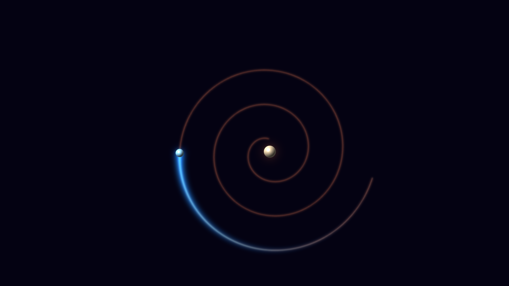
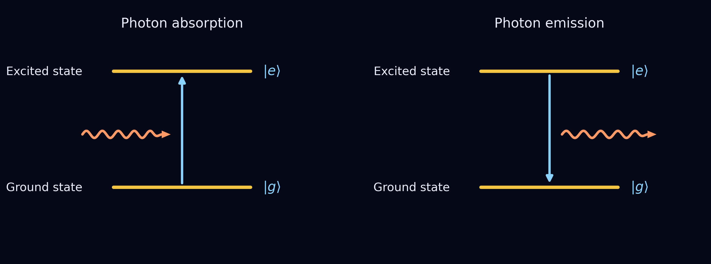
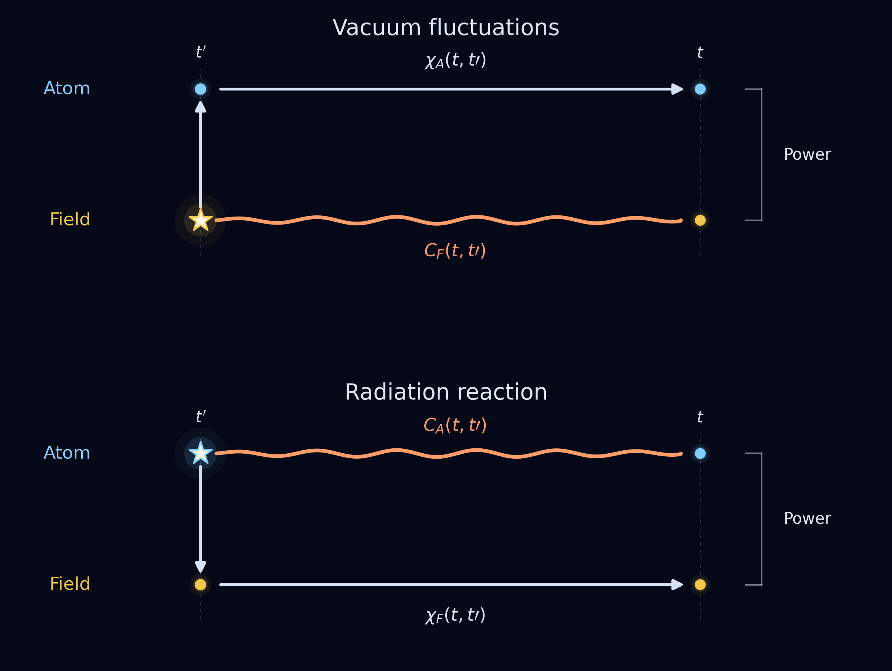
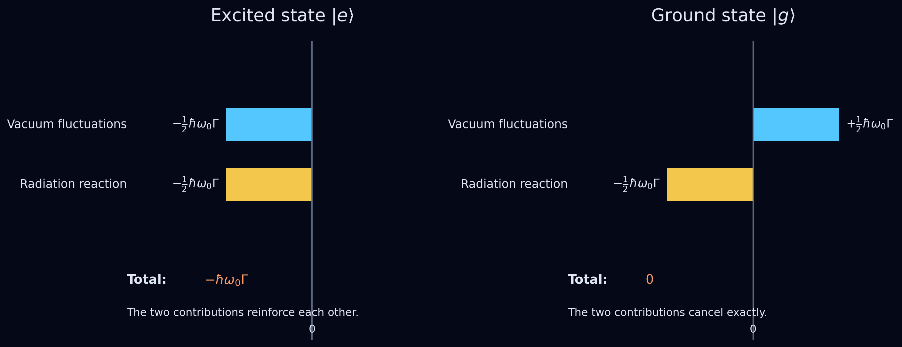

# Spontaneous Emission Revisited

*A closer look at what causes spontaneous emission reveals a careful balance, and restores the role of an atom's own radiation field*

> Caption: **The classical picture. An orbiting electron radiates, loses energy and spirals into the nucleus. The bright arc marks the recent path, the fading line the earlier path.**
> Alt text: A glowing blue electron spiralling inward toward a pale nucleus on a dark background, with a bright arc for its recent path and a fainter spiral for its earlier path.
> Source: Image by author.

## The classical atom should collapse

- Before quantum mechanics: Maxwell's equations say an electron orbiting a nucleus should radiate continuously.
- An accelerating charge radiates. The energy carried away must come from somewhere, so the electron loses orbital energy and spirals into the nucleus.
- This is the problem of *radiative damping*. The field generated by the electron acts back on the electron itself: **radiation reaction**, or **self-force**.
- Much work went into this force (e.g. the Abraham–Lorentz description of an accelerated point charge).
- But atoms are stable. The classical picture of an orbiting electron must be wrong.

*Note: The classical point-charge self-force has its own mathematical difficulties. We leave them for a separate article.*

## Quantum mechanics introduces stable atomic states

- Quantum mechanics replaces orbits by energy eigenstates: stationary probability distributions with well-defined energy.
- For an isolated atom these states are stable. Even an excited state would stay excited forever if there were no coupling to the radiation field.
- Add an external classical field: it creates a superposition of eigenstates, so the expectation value of the electric dipole oscillates.
- Depending on the phase between field and dipole, energy flows into or out of the atom: **stimulated absorption** and **stimulated emission**.
- The wavefunction shapes set the transition dipole matrix elements, and therefore the transition strengths.
- (Link to the earlier post on the semiclassical picture.)
- What this picture cannot explain: **spontaneous emission from an excited eigenstate with no applied field.**
  - No pre-existing oscillating average dipole to radiate.
  - No external field to stimulate a transition.

> Caption: **Figure 1. Absorption (left) and emission (right) of a photon by a two-level atom with ground state |g⟩ and excited state |e⟩.**
> Alt text: Two energy-level diagrams on a dark background. Left: a wavy arrow (a photon) arrives and an upward arrow lifts the atom from the ground state |g⟩ to the excited state |e⟩. Right: a downward arrow takes the atom from |e⟩ to |g⟩ while a wavy arrow (a photon) leaves.
> Source: Image by author.

## Quantizing the field seems to solve everything

- Next step: quantize the electromagnetic field itself.
### Assumptions that lead to the JC model

- Standard textbook model: Jaynes–Cummings (JC). To get there we make assumptions:
  - the atom has only two levels, |g⟩ and |e⟩;
  - the field is a single quantized mode;
  - the atom couples to the field through its electric dipole;
  - the rotating-wave approximation (RWA): keep only the terms that (near resonance) conserve energy, drop the rapidly oscillating counter-rotating terms.
- Key point: once the interaction is included, the original (bare) atom and field eigenstates are no longer pure eigenstates of the combined system. The interaction mixes them.
- Which mixing is included, and therefore which transitions between the original eigenstates are included, is set by our assumptions.

### What happens within JC

- The interaction couples

$$
|g,n\rangle \longleftrightarrow |e,n-1\rangle
\qquad\text{or equivalently}\qquad
|e,n\rangle \longleftrightarrow |g,n+1\rangle .
$$

- The emission rate scales with n+1:
  - the n is **stimulated** emission (needs photons already present),
  - the 1 is **spontaneous** emission (survives when n = 0).
- So even with an empty mode,

$$
|e,0\rangle \longleftrightarrow |g,1\rangle
$$

  is allowed: the excited atom emits a photon into an initially empty mode.
- That process is exactly the thing whose cause we want to understand: The fact that a mode with 0 photons can trigger emission from an atom in the excited state. Naively speaking teh field is vacuum, so would have no field and the atom is in an energy eigenstate without dipole.. still the coupling described in the JC Hamiltonian leads to emssion.
- The opposite process |g,0⟩ → |e,1⟩ is absent from the JC interaction: this is a consequence of the RWA assumption, which removes the counter-rotating term.
- So within JC the mixing is limited to |e,n⟩ and |g,n+1⟩ pairs, and |g,0⟩ is exactly stationary.
- Beyond JC (no RWA, many modes): the mixing is richer, and the true ground state is a dressed state, not simply the bare |g,0⟩.
- Common explanation: **vacuum fluctuations trigger spontaneous emission.**
- The environment matters, as seen in earlier posts: mirrors change lifetimes, strongly coupled cavities give coherent exchange (vacuum Rabi oscillations).

*Note: An ideal single-mode JC model gives coherent oscillations, not irreversible exponential decay. Exponential decay needs a continuum of modes or a dissipative environment.*

- These models describe observations extremely well. End of story?

## But where did the atom's own radiation field go?

- We started with a classical picture: the electron's own field causes radiative damping.
- We ended with a quantum picture: vacuum fluctuations trigger emission.
- These sound like very different explanations. What happened to radiation reaction?
- The question is old.
  - Slater (1924), in the Bohr–Kramers–Slater proposal: atoms interact through "virtual" fields; an atom's own field plays a role in spontaneous transitions, external radiation in induced ones. Milloni (1975): " It was generally felt that (spontaneous emission) could be attributed to the radiation reaction of the atomic-transition dipole
moment back on itself, in complete analogy to the radiative. damping of a classical oscillating dipole. (...) On the other hand, Welton's heuristic argument concerning the Lamb shift' influences many modern physicists to attribute spontaneous emission
to the effect of vacuum-field fluctuations. Indirect support for this point of view comes from semiclassical radiation theories." 
- "The quantitative results for these corrections are of course well established. The physical interpretations remain however more controversial. Two extreme points of view have been investigated. In the first one, the interaction of the electron with the quantum fluctuations of the vacuum field, the so-called « vacuum fluctuations », is considered as playing the central role. (...) In the second point of view, the basic physical mechanism is identified as the interaction of the electron with its own field, the so called « radiation reaction »"
> ** In a letter to Nature in 1924 Slaterwrites: "The part of the field originating from the given atom itself is supposed to induce a probability that that atom lose energy spontaneously, while radiation from external sources is regarded as inducing additional probabilities that it gain or lose energy, much as Einstein has suggested. . . . ' [J. C. Slater, Nature 113, 307 (1924)]"**
  - Resembles Einstein's earlier split into spontaneous and stimulated transitions.
  - Later, vacuum fluctuations became the prominent explanation, especially with QED.
- 1970s debate: Milonni, Smith, Ackerhalt, Knight, Eberly and others showed that different (equivalent) mathematical descriptions can assign spontaneous emission mostly to one mechanism or the other.
- Early 1980s: Dalibard, Dupont-Roc and Cohen-Tannoudji (DDC) proposed a natural, physically motivated way to separate the two: symmetric operator ordering.
- To see what they found we need a short intermezzo on correlations and responses.

## Intermezzo: Events and Effects

### Why two random events are not necessarily independent

- Picture people walking along a street. Sometimes it rains, sometimes someone carries an open umbrella.
- If independent: P(rain and umbrella) = P(rain) P(umbrella).
- They are not independent: **rain causes umbrellas to open.**
- History matters. Suppose it rained five minutes ago:
  - rain tends to persist, so rain now is more likely;
  - people who noticed it may still hold their umbrellas open.
- So open umbrella and rain now are more strongly linked than the product of probabilities suggests.
- Two separate ingredients:
  - **Correlation:** how does knowing about earlier rain change our expectation of rain now? (the statistical memory of the rain)
  - **Susceptibility:** how strongly, and for how long, do people respond to rain? (the response of the umbrellas)
- Not only five minutes ago: all of the relevant history contributes.
- The logic only needs two things: something that fluctuates and has a memory (the rain), and something that responds to it (the umbrellas).
- In the street the roles are fixed. For the atom and the field they are **not**: each can play either role.
  - Field fluctuates, atom responds (path 1).
  - Atom fluctuates, field responds (path 2).
- So we apply the same rain-and-umbrellas logic twice, with the roles swapped.

### Path 1: the field fluctuates, the atom responds

- Interaction of dipole d with field E (one direction for simplicity): H_int = −dE.
- Both fluctuate with zero mean: ⟨E⟩ = 0, ⟨d⟩ = 0.
- If independent, ⟨Ed⟩ = ⟨E⟩⟨d⟩ = 0.
- But they interact: a field fluctuation disturbs the dipole, and the response does not vanish immediately. The field also remembers its earlier value.
- Same logic as rain and umbrellas. Two functions:
  - C_F(t,t′): **correlation** of the field between earlier time t′ and now t (the rain).
  - χ_A(t,t′): **susceptibility** of the atom, its response at t to a disturbance at t′ (the umbrellas).
- A fluctuation at t′ shapes our expectation of both the field and the dipole now, so ⟨Ed⟩ ≠ ⟨E⟩⟨d⟩.
- Why the time derivative? Energy transfer is work, and work is force times velocity: the power delivered to the dipole is E(t) ḋ(t). So we need the time derivative of the atomic response.
- Add up all earlier times:

$$
\boxed{
\left\langle\dot H_A(t)\right\rangle_{\mathrm{vf}}
\propto
\int_{t_0}^{t}dt'\,
C_F(t,t')\,
\frac{\partial}{\partial t}\chi_A(t,t')
}
$$

- This is the **vacuum-fluctuation contribution**: the field fluctuates, the atom responds, the correlation gives a systematic average energy transfer.
- (Schematic: coupling constants and operator conventions left out.)

### Path 2: the atom fluctuates, the field responds

- Now swap the roles. The atomic dipole fluctuates too, and an earlier fluctuation generates a field that acts back on the atom.
- Same logic as the rain and umbrellas, with the atom now playing the part of the rain and the field the part of the umbrellas.
- Two functions:
  - C_A(t,t′): **correlation** of the atomic dipole between t′ and t (the memory of the fluctuating atom, the role the rain played).
  - χ_F(t,t′): **susceptibility** of the field, its response at t to a dipole disturbance at t′ (the role the umbrellas played).
- Add up all earlier times:

$$
\boxed{
\left\langle\dot H_A(t)\right\rangle_{\mathrm{rr}}
\propto
\int_{t_0}^{t}dt'\,
\chi_F(t,t')\,
\frac{\partial}{\partial t}C_A(t,t')
}
$$

- This is the **radiation-reaction contribution**: the atom fluctuates, generates a field, and then feels its own radiation.
- Both expressions have the same structure as those derived by Audretsch and Müller with the DDC formalism.
- Note the symmetry: in path 1 the field supplies the correlation and the atom the response; in path 2 the roles are swapped.

> Caption: **Figure 2. The two contributions to the power. Top: vacuum fluctuations. A field fluctuation at the earlier time t′ (star) is correlated with the field at t (wavy line, C_F) and drives an atomic response (straight arrows, χ_A). Bottom: radiation reaction. A dipole fluctuation of the atom at t′ (star) is correlated with the atom at t (C_A) and drives a response of the field (χ_F). In both cases the two paths meet at time t and set the power ⟨Ḣ_A(t)⟩ delivered to the atom. Wavy lines: correlations. Straight arrows: responses.**
> Alt text: Two time-line diagrams, each with an atom line and a field line running from an earlier time t′ to the present time t. Top, vacuum fluctuations: a star on the field line at t′ is joined to the field at t by a wavy line labelled C_F, and an arrow leads up to the atom and along its line, labelled χ_A. Bottom, radiation reaction: a star on the atom line at t′ is joined to the atom at t by a wavy line labelled C_A, and an arrow leads down to the field and along its line, labelled χ_F. A bracket at time t marks the resulting power in both panels.
> Source: Image by author.

*Scientific qualification: Rain and umbrellas are classical. Quantum correlations cannot always be read as classical conditional probabilities. The quantum theory uses symmetrized operator correlations (anticommutators), while susceptibilities involve commutators. The analogy conveys intuition and does not reproduce the derivation.*

## Two Contributions, One Physical Result

### A problem with separating the field

- Split the total field: E = E_free + E_source.
  - Free field: what would exist without radiation from this atom (vacuum fluctuations).
  - Source field: generated by the atom itself (radiation reaction).
- Looks like a natural split. But observables are operators, and operators need not commute.
- The complete atom and field operators commute at equal times. After the split, the free and source parts generally do **not** commute with the atomic operators.
- So the amounts assigned to vacuum fluctuations and radiation reaction depend on operator ordering.
- Different orderings give the same total rate, but divide it differently.
- Milonni and Smith showed how dramatic this can be:
  - one ordering: radiative correction comes entirely from the atom's self-field;
  - another: vacuum fluctuations become explicit.
- The full physics is unchanged. So how do we choose a separation?

### The DDC proposal: make each contribution Hermitian

- 1982: Dalibard, Dupont-Roc and Cohen-Tannoudji.
- The total rate of change of an atomic observable is represented by a Hermitian operator.
- If vacuum fluctuations and radiation reaction are to be separately meaningful, each contribution should be Hermitian too.
- Together with the appropriate symmetry conditions this selects **symmetric ordering** of atomic and field operators.
- Result: two separately Hermitian rate operators, which lead naturally to the correlation–susceptibility expressions above.
- Here is why the result below comes out the way it does:
  - Vacuum fluctuations are proportional to the **atomic susceptibility** χ_A. For a two-level atom, χ_A **changes sign** between |e⟩ and |g⟩.
  - Radiation reaction is proportional to the **atomic symmetric correlation** C_A. For a two-level atom, C_A is **the same** in |e⟩ and |g⟩.
  - The field quantities C_F and χ_F are properties of the vacuum alone and do not depend on the atomic state.

### An unexpected balance

- Γ: total spontaneous-emission rate of the two-level atom. ħω₀: transition energy. Entries are contributions to ⟨Ḣ_A⟩, the mean rate of change of atomic energy.

| Initial state | Vacuum fluctuations | Radiation reaction | Total |
|---|---|---|---|
| Excited | −½ħω₀Γ | −½ħω₀Γ | −ħω₀Γ |
| Ground | +½ħω₀Γ | −½ħω₀Γ | 0 |

- Excited atom: the two contributions **reinforce** each other. Each accounts for half of the energy-loss rate (in this symmetric decomposition).
- Ground-state atom: the vacuum-fluctuation term flips sign (because χ_A flips sign), the radiation-reaction term does not (because C_A does not). They **cancel exactly**.
- The atom stays in its ground state: no spontaneous absorption from the vacuum.

> Caption: **Figure 3. Contributions to the mean rate of change of atomic energy in the symmetric (DDC) separation. Excited state (left): vacuum fluctuations and radiation reaction both lower the energy and add up to the full spontaneous-emission rate. Ground state (right): vacuum fluctuations raise the energy, radiation reaction lowers it by the same amount, and the total vanishes.**
> Alt text: Two horizontal bar charts on a dark background. Excited state |e⟩: vacuum fluctuations and radiation reaction are both bars to the left of zero, each −½ħω₀Γ, with a total of −ħω₀Γ. Ground state |g⟩: vacuum fluctuations is a bar to the right of zero (+½ħω₀Γ) and radiation reaction a bar to the left (−½ħω₀Γ), with a total of 0.
> Source: Image by author.

*Important distinction: The positive and negative terms are contributions to a mean energy-transfer rate, not two separately observed streams of real excitation and de-excitation events. The physical ground-state excitation rate is zero.*

- Ground-state stability does not depend on operator ordering. Symmetric ordering simply gives a transparent reason for it.
- Link back to JC: there, the rotating-wave approximation removes |g,0⟩ → |e,1⟩ by hand. In the full quantum-field description, stability comes from the complete dynamics, and symmetric ordering shows it as a cancellation between two contributions.

## Does It Matter?

- A more balanced picture of spontaneous emission:
  - the atom's own radiation field did not disappear when we moved from classical to quantum theory;
  - vacuum fluctuations did not simply replace radiation reaction;
  - both are present in the full quantum-field description.
- What operator ordering changes is how the atomic energy-transfer rate is divided between them.
- DDC's Hermiticity criterion gives a physically motivated division: equal contributions for the excited state, exact cancellation for the ground state.
- Caution: this does not mean the two halves of a single atom's decay rate have been measured separately.
- But the underlying distinction, vacuum correlations versus causal source radiation, is experimentally meaningful.
- 2026 experiment: correlations from vacuum fluctuations and from source radiation were distinguished through their different causal properties. The authors state that the results support the physical interpretation of the separation proposed by Dalibard and colleagues in 1982. **[Herter et al. (2026), Nature Communications. Verify authors, title and details before publishing.]**
- Details of that experiment, and the related Fermi two-atom problem: separate article.

## A final question: what if we accelerate the atom?

- So far: an atom at rest in the vacuum. By special relativity the same holds for constant velocity.
  - Ground state: vacuum fluctuations and radiation reaction balance.
  - Excited state: they reinforce each other and give spontaneous emission.
- But the two mechanisms are different things:
  - one depends on the correlations of the vacuum field;
  - the other on the atom's own fluctuations and the response of the field it generates.
- **What happens if we accelerate the atom?** Or hold it at rest in a gravitational field?
- Does the balance survive? That is where we go next.

---

## References and editorial notes

- Slater (1924), *Nature* 113, 307: early self-field / virtual-field interpretation (Bohr–Kramers–Slater context). Verify framing.
- Milonni & Smith (1975), *Physical Review A* 11, 814: operator-ordering dependence and interpretation of radiative corrections.
- Dalibard, Dupont-Roc & Cohen-Tannoudji (1982), *Journal de Physique* 43, 1617: symmetric ordering and the separation of vacuum fluctuations and radiation reaction.
- Dalibard, Dupont-Roc & Cohen-Tannoudji (1984), *Journal de Physique* 45, 637: fluctuation–response formalism for a small system coupled to a reservoir.
- Audretsch & Müller (1994), *Physical Review A* 50, 1755: two-level atom and fluctuation–reaction separation, including accelerated motion.
- Herter et al. (2026), *Nature Communications*: experimental separation of vacuum-induced and source-radiation correlations. Verify.

### Items for later development

- Confirm the exact Slater quotation and how Slater's 1924 idea is framed (original source or Milonni & Smith).
- Verify the Herter et al. (2026) citation details.
- Decide whether the explicit anticommutator/commutator definitions go in the main text or an appendix.
- Check how much semiclassical material from earlier posts needs repeating; add the link.
- Optional figure: rain-and-umbrellas showing the two routes from an earlier event to the present (correlation of the fluctuating quantity, response of the other), drawn once and then repeated with the roles swapped.
- Keep the Fermi two-atom problem and the classical point-charge self-force for separate posts.
- Preserve the acceleration question without explaining the result yet.
