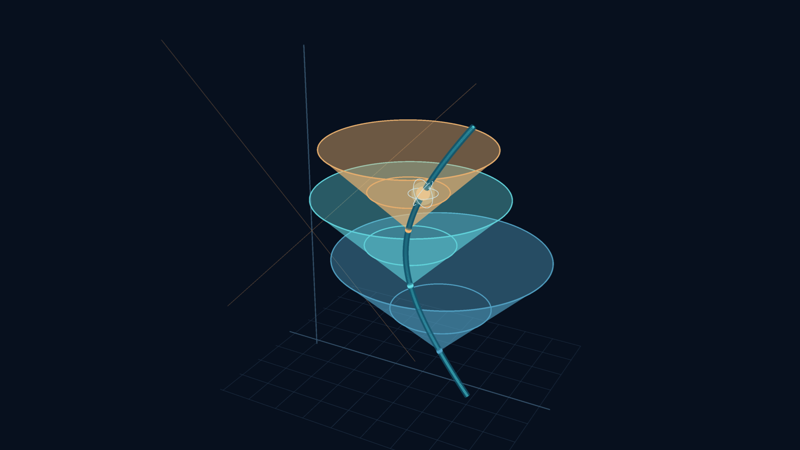
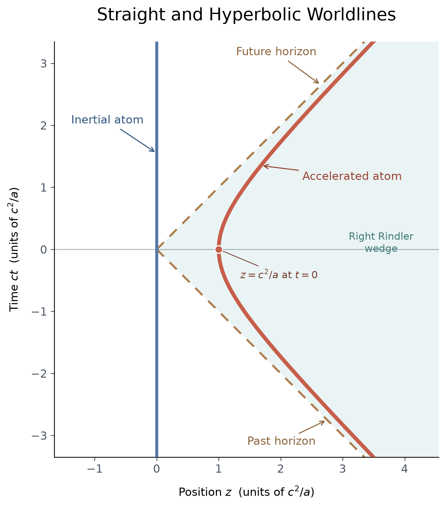
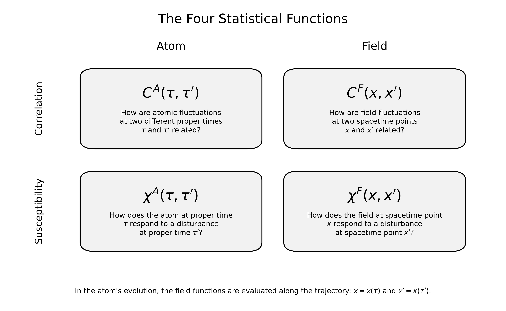
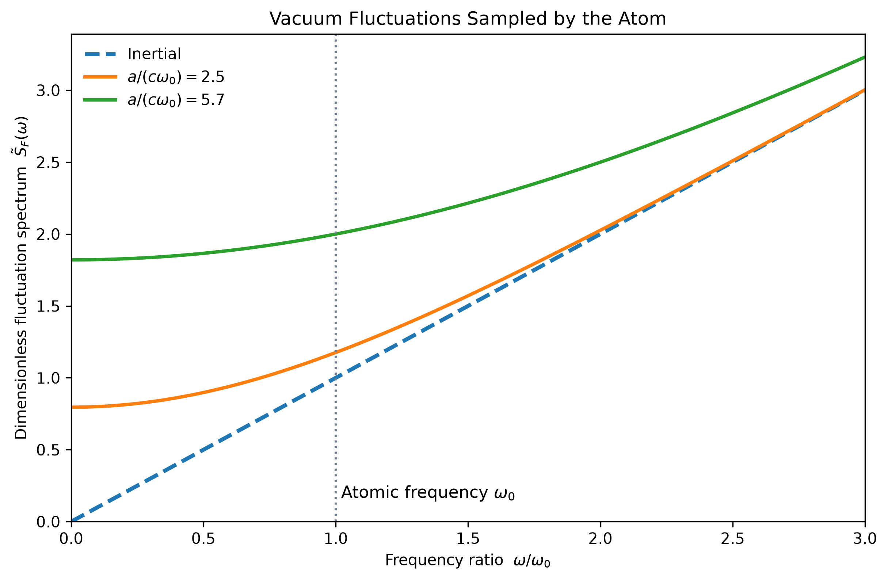
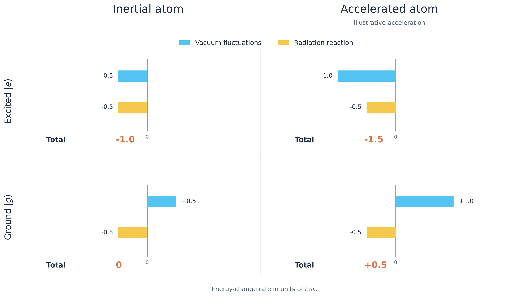
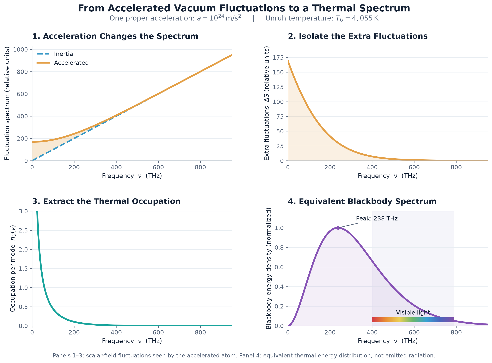

<!--
date: 2026-11-07
revision: 4

medium:
  topics:
    - Quantum Physics
    - Unruh Effect
    - Quantum Field Theory
    - Atomic Physics
    - Spontaneous Emission
  seo_title: What Happens When You Accelerate an Atom? The Unruh Effect
  seo_description: An accelerating atom experiences the quantum vacuum as a thermal bath. Follow vacuum fluctuations and radiation reaction to discover the Unruh effect.
  preview_title: What Happens When You Accelerate an Atom?
  preview_subtitle: A delicate balance keeps atomic ground states stable. What happens when the atom accelerates?
  publication:
  canonical_url:
-->

# What Happens When You Accelerate an Atom?

## A delicate balance keeps atomic ground states stable. What happens when the atom accelerates?

> Caption: An atom follows an accelerated worldline through spacetime. Light cones along its path illustrate the causal structure surrounding its motion. Image by author.
> Alt text: Dark three-dimensional spacetime illustration with a luminous turquoise curved worldline and translucent blue and amber light cones around an atom.

<!--
WORKING OUTLINE — POST 4, ATOMIC RADIATION SERIES
Primary reference: Audretsch & Müller, "Spontaneous excitation of an accelerated atom: The contributions of vacuum fluctuations and radiation reaction."
Model: pointlike two-level detector coupled to a massless scalar field in 3+1D Minkowski spacetime, eternally uniform proper acceleration, long-time/stationary limit.
Audretsch map: DDC equations (26) and (27); accelerated worldline (52); field functions (53)–(54); VF/RR contributions (55)–(59); transition coefficients (66).
Units: author uses ℏ=c=k_B=1; restore constants for physical acceleration, occupation and Unruh temperature.
Keep equation numbers here in comments and references only; never in final narrative prose.
Story: exact cancellation → accelerate → worldline → four functions → enhanced VF → imbalance → thermal occupation → detailed balance → Hawking/frequency mixing.
Figure 4 uses an illustrative doubling of the VF magnitude, independent of Figure 5's specified physical acceleration.
-->

## The Cancellation That Should Not Care About Motion

<!-- - Open with the puzzle rather than a long recap: the ground-state atom is stable because vacuum fluctuations and radiation reaction cancel exactly. Why should accelerating the *same* atom upset that balance?
- Recall just enough of Post 3: symmetric operator ordering lets us distinguish the vacuum-fluctuation (VF) and radiation-reaction (RR) contributions.
- Inertial ground state: VF raises atomic energy; RR lowers it; total energy-change rate is zero.
- Excited state: both contributions reduce atomic energy, leading to spontaneous decay.
- No heat has been added; the atom is still in the Minkowski vacuum.
- Motivate with the Unruh/Hawking connection as a question, not yet as the answer.
- Introduce the modelling choice **in visible article prose**: earlier posts discussed electromagnetic radiation; to expose the mechanism cleanly, follow Audretsch's simpler massless **scalar** field coupled to a two-level atom. Later clarify which conclusions generalize to an electromagnetic dipole.-->

Excited atoms emit light, and the properties of that light tell us a great deal about the atom. The process is called spontaneous emission. Spontaneous means untriggered: even in vacuum, with nothing disturbing it, an excited atom is expected to radiate. So what does trigger the emission? Classically, the answer is a self-force: the electron orbiting the nucleus radiates and loses energy. In the quantum description the atom’s energy states are stable, and an isolated atom stays in an excited state forever. Spontaneous emission only appears once we quantize the electromagnetic field and let it interact with the atom.

A common explanation is that vacuum fluctuations of the field make the excited atom emit. In quantum mechanics the field is never completely absent. Even in its lowest energy state it carries some energy and fluctuates. But a closer look shows that vacuum fluctuations alone do not describe spontaneous emission. The atom’s effect on the field has to be included as well: the field the atom itself produces acts back on it. This radiation reaction is the quantum counterpart of the classical self-force. For an excited atom, vacuum fluctuations and radiation reaction both lower its energy, and together they produce the decay. For a ground-state atom, in the symmetric operator ordering of Post 3, they cancel. That cancellation is why we never speak of spontaneous absorption, an atom excited by a vacuum fluctuation.

Everything so far describes an atom at rest. By the principle of relativity, the same holds for an atom moving at constant velocity. But what if the atom accelerates? At first sight nothing should change. The atom’s internal dynamics are the same, and the field is in the same vacuum state, so the balance should survive. This intuition can be challenged. Even what counts as empty vacuum can depend on how the atom that experiences it is moving.

To follow this through, we use the analysis of Jürgen Audretsch and Rainer Müller [1]. They treat the field as a massless scalar field instead of the electromagnetic one. This removes polarization and the angular structure of dipole radiation, and makes the calculation more transparent. The same balance appears: for an atom at rest, vacuum fluctuations and radiation reaction still cancel in the ground state and reinforce in the excited state. The atom is an idealized pointlike two-level system, and we consider uniform acceleration that lasts forever, in the long-time limit. Where the electromagnetic case would differ, we will say so. The question of how accelerated observers and detectors see the vacuum goes back to the 1970s, to the work of Fulling, Davies and Unruh, and others, such as Hu and Hsiang, have studied accelerated atoms interacting with a quantum field. We draw on their results where they help, and the references are at the end.

## What Constant Acceleration Looks Like

Accelerating can mean two different things. From the laboratory, the atom's velocity changes. For the atom, what matters is what it feels: its proper acceleration, the acceleration that an accelerometer carried along with the atom would measure. We take this proper acceleration to be constant, with value *a*. In the laboratory the atom's acceleration is not constant. The same push produces smaller and smaller changes in laboratory velocity as the atom approaches the speed of light.

We describe the motion in an inertial laboratory frame, with time *t* and position *z* along the direction of acceleration. The atom's own history is labelled by its proper time τ, the time on a clock it carries. The atom's internal dynamics, including its transition frequency ω₀, run in τ. Constant proper acceleration then gives the trajectory

$$
\begin{aligned}
ct(\tau) &= \frac{c^2}{a}\,\sinh\!\left(\frac{a\tau}{c}\right),\\[4pt]
z(\tau) &= \frac{c^2}{a}\,\cosh\!\left(\frac{a\tau}{c}\right).
\end{aligned}
$$

Eliminating τ gives

$$
z^2 - (ct)^2 = \left(\frac{c^2}{a}\right)^2 .
$$

This is a hyperbola in the (*z*, *ct*) plane, shown in Figure 1 next to the straight worldline of an inertial atom. At early and late times the hyperbola approaches straight lines at 45°. The atom's laboratory velocity tends toward *c*, but never reaches it.

> Caption: **Figure 1.** An inertial atom follows a straight worldline. Under constant proper acceleration, the worldline becomes a hyperbola with past and future Rindler horizons as its asymptotes. Image by author.
> Alt text: White spacetime diagram with position z on the horizontal axis and ct vertically. A blue straight inertial worldline lies at z = 0, while a red hyperbola traces an accelerating atom within a lightly shaded Rindler wedge bounded by brown dashed null lines.

These two diagonal lines, *z* = ±*ct*, are the past and future Rindler horizons. They are not tied to any particular event on the trajectory. They are fixed by the entire, eternally accelerated worldline. Because the atom never stops accelerating, a light signal sent from beyond the future horizon never reaches it, however long the atom waits. In the same way, the atom can never send a signal to events beyond the past horizon. A horizon is a causal boundary, not a wall, and nothing at the horizon radiates heat. It only marks which events the atom can and cannot exchange signals with.

This hyperbola is the path along which the atom meets the field. The next step is to see where that path enters the balance.

## Which of Our Four Functions Changes the Balance?

- Brief recap of the four **statistical functions**, using one term consistently: two belong to the atom, two to the field.
- Correlation asks how fluctuations at two proper times or spacetime points are related; susceptibility asks how a disturbance at one influences another.
- Atom: Cᴬ(τ,τ′) and χᴬ(τ,τ′), expressed in **proper times**.
- Field: Cᶠ(x,x′) and χᶠ(x,x′), expressed in **spacetime coordinates**.
- The link is x=x(τ), x′=x(τ′): the atom samples the field along its worldline.
- VF contribution = field correlation Cᶠ paired with the proper-time derivative of the atomic susceptibility χᴬ.
- RR contribution = field susceptibility χᶠ paired with the proper-time derivative of the atomic correlation Cᴬ.
- Internal atom unchanged by the idealized acceleration: both atomic functions retain their proper-time form.
- Field response: for a massless scalar field in flat 3+1D, the commutator has support on the light cone; points separated along the atom's timelike worldline cannot exchange a delayed sharp field impulse. Only a *distributional local contribution* survives in the RR integral.
- Explain that the coincident term is singular and cannot be treated as the ordinary number χᶠ(τ,τ). The evaluated **radiation-reaction energy-change contribution** is unchanged for inertial and uniformly accelerated motion in this model.
- Crucial remaining change: the vacuum field **correlation sampled along the trajectory** Cᶠ(x(τ),x(τ′)). The Minkowski vacuum itself is unchanged.

> Caption: **Figure 2.** The atom's statistical functions refer to two proper times, τ and τ′; the field's functions refer to spacetime events x and x′. Acceleration changes the relationship between the two through the worldline x(τ). Image by author.
> Alt text: Two-by-two diagram with Atom and Field columns and Correlation and Susceptibility rows. Four neutral boxes identify the atomic and field correlation and susceptibility functions, each with a short explanation.

<!-- Figure 2 is updated: literal line-break artifact fixed and all boxes use neutral backgrounds. -->

## Acceleration Changes Which Vacuum Fluctuations the Atom Samples

- Along an inertial worldline, the real symmetric scalar-field correlator has the characteristic short-distance dependence Cᶠ(u) ∝ −1/u², where u=τ−τ′, understood as a distribution.
- Along the accelerated worldline, inserting the sinh/cosh trajectory into the same Minkowski-vacuum two-point function gives Cᶠₐ(u) ∝ −a²/sinh²(au/2c) away from coincidence (restore dimensional normalization as appropriate).
- This is not a change to the quantum state: it is a change in **which spacetime correlations the atom samples at successive proper times**.
- In the VF integral, the derivative of the atomic susceptibility oscillates at ω₀; in frequency language, the atom selects the field's symmetric fluctuation spectrum at its transition frequency.
- Explain why the **inertial scalar spectrum** is a straight line:
  - In three spatial dimensions, the density of massless modes per frequency grows as ω².
  - Each canonically normalized field mode is a harmonic oscillator with zero-point energy ½ℏω.
  - Its **field-amplitude variance** is proportional to 1/ω (root-mean-square amplitude proportional to 1/√ω).
  - Combined spectral weight: ω² × 1/ω ∝ ω.
- This is not the electromagnetic electric-field spectrum: that scales as ω³ in the inertial vacuum, because the coupling/field observable differs.
- The accelerated scalar symmetric spectrum is the inertial spectrum multiplied by coth(πc|ω|/a). At ω₀, acceleration increases the value sampled by the atomic susceptibility. Figure 3 uses a/(cω₀), with c explicitly restored.
- Figure 3 compares the inertial case with two accelerations, expressed as a/(cω₀); the green curve at a/(cω₀)≈5.7 doubles the symmetric fluctuation spectrum at ω₀.
- Optional *one-sentence* intuition here: an individual inertial plane-wave mode is Doppler-chirped along the accelerated trajectory. Defer detailed frequency mixing to the final section.

> Caption: **Figure 3.** The inertial scalar-field vacuum spectrum grows linearly with frequency. Acceleration enhances the spectrum sampled by the atom at its transition frequency ω₀ (dotted line). For the green curve, a/(cω₀)≈5.7, the fluctuation strength at ω₀ doubles. Image by author.
> Alt text: Graph of vacuum-fluctuation spectral strength versus frequency relative to the atomic transition frequency. A dashed straight inertial baseline is compared with curved accelerated spectra above it, with a vertical dotted reference at ω/ω₀ = 1.

## Acceleration Breaks the Balance

- Use the changed field correlation in the VF contribution; its magnitude increases for both atomic states.
- Ground state: the positive VF contribution is stronger, while the negative RR contribution is unchanged; their cancellation fails and upward transitions become possible.
- Excited state: enhanced negative VF contribution adds to unchanged negative RR; downward transitions become faster.
- The *same* atom, field state, and internal susceptibility — a changed trajectory is enough.
- Raise the energy question here: an external agent must do work to maintain the accelerated motion; don't imply the inertial vacuum is an unlimited energy source.
- Figure 4 compares excited and ground states, inertial and accelerated, on a common scale. Yellow RR bars stay fixed; cyan VF bars change. Use the **same acceleration as the green curve in Figure 3**.
- Avoid mentioning the not-yet-defined thermal occupation symbol in visible prose or captions. For the **illustrative** acceleration used in Figure 4, VF magnitude doubles: ground total 0 → +0.5 and excited total −1 → −1.5, in units of ℏω₀Γ, where Γ is the inertial spontaneous-emission rate.

> Caption: **Figure 4.** Acceleration breaks the balance. At the same acceleration as the green curve in Figure 3, vacuum fluctuations (cyan) contribute twice as much, while radiation reaction (yellow) remains unchanged. The ground state can gain energy and the excited state loses energy faster. Rates are in units of ℏω₀Γ. Image by author.
> Alt text: White four-panel bar chart with columns Inertial atom and Accelerated atom and rows Excited and Ground. Cyan vacuum-fluctuation bars increase in magnitude under acceleration while yellow radiation-reaction bars remain identical. Totals read −1 and −1.5 for the excited state, and 0 and +0.5 for the ground state.

<!-- Figure 4 parameter note: the illustrative doubling corresponds to n_U(ω₀)=0.5, or a/(cω₀)=2π/ln(3)≈5.72. Keep n_U out of the panel until defined. -->

## The Extra Fluctuations Reveal a Temperature

- Return to the two curves in Figure 3. Subtract the inertial baseline from the accelerated spectrum; the result is additional **spectral density**, not the integrated area of the shaded region.
- Rewrite the coth enhancement as an inertial term plus an additional term; divide the latter by twice the inertial scalar spectral density.
- The residual dimensionless factor is n_U(ω)=1/[exp(2πcω/a)−1] for ω>0.
- Recognize exactly the Bose–Einstein occupation number; compare with n_T(ω)=1/[exp(ℏω/k_BT)−1].
- Read off the Unruh temperature: T_U=ℏa/(2πck_B).
- Figure 5 uses ordinary frequency ν=ω/(2π) in THz, whereas Figure 3 and the text use angular frequency ω. This is a change of frequency units, not of physics.
- Figure 5 visual sequence:
  1. Inertial baseline and accelerated fluctuation curve, with the **difference shaded**.
  2. Subtract the baseline and plot the additional spectral density ΔS.
  3. Remove the scalar-field frequency factor to obtain thermal occupation per mode.
  4. From that **same occupation factor**, construct the familiar equivalent blackbody *energy density per frequency*, ∝ ω³n_U(ω), with a physically placed visible-light rainbow.
- Explain why the last curve has a peak but the occupation number does not: multiply by mode density (ω²) and energy per quantum (ℏω).
- Make clear that step 4 is a **change of observable for comparison**, not a claim that inertial observers see blackbody photons emerging from the Minkowski vacuum.
- The example in Figure 5 uses a=10²⁴ m/s², giving T_U≈4,055 K and a blackbody energy-density peak near 238 THz (infrared, per unit frequency). At Earth's 1g, T_U≈4×10⁻²⁰ K.
- The phrase **vacuum temperature** refers to the temperature *experienced by the eternally uniformly accelerating detector*, not an absolute temperature of empty space.
- Explain briefly that the ideal exact thermal result assumes stationary/eternal uniform acceleration; finite-duration motion introduces transients.

> Caption: **Figure 5.** Subtracting the inertial scalar-field fluctuation spectrum leaves an acceleration-dependent contribution. Removing the underlying frequency factor reveals the Planck occupation number. The final panel shows the *equivalent* blackbody energy spectrum, with visible frequencies marked — not radiation emitted by the Minkowski vacuum. All panels use a=10²⁴ m/s² (T_U≈4,055 K). Image by author.
> Alt text: Four white-background plots: the accelerated and inertial spectra with their difference shaded orange; the isolated extra fluctuation spectrum; the decreasing Bose–Einstein occupation per mode; and a peaked purple equivalent blackbody energy spectrum with a rainbow strip marking the visible-light frequency range.

## What a Thermal Vacuum Means for the Atom

- Define Γ as the inertial spontaneous decay rate of the two-level system and n_U as the Unruh occupation at the atomic transition frequency ω₀.
- The upward transition rate is Γ↑=Γ n_U(ω₀), so ground-state excitation is possible.
- The downward rate is Γ↓=Γ[1+n_U(ω₀)]: spontaneous decay (the **1**) plus a stimulated contribution (the **n**).
- Explicit callback to Post 2: the familiar bosonic **n+1** factor has returned, now with an acceleration-dependent occupation number.
- Detailed balance: Γ↑/Γ↓=exp[−ℏω₀/(k_BT_U)]; the steady-state population ratio is thermal.
- Distinguish the excited-state downward transition rate from the relaxation rate of populations, Γ↑+Γ↓.
- Nuance: in a real electromagnetic dipole model, acceleration can add frequency-dependent response prefactors (so the absolute rates need not be a simple Planck factor times the inertial rates), while the thermal detailed-balance ratio persists for a suitable ideal stationary setup.
- Detector excitation is not the same observable as radiation flux measured far away. The external work maintaining the acceleration matters to energy accounting.

## Another Perspective: Chirped Frequencies and Hawking Radiation

- Revisit the quick intuition introduced at Figure 3: a Minkowski plane-wave mode of fixed laboratory frequency acquires an **exponentially chirped phase** when evaluated along an eternally uniformly accelerated worldline.
- Consequently, positive frequency with respect to inertial time does not remain purely positive frequency in the accelerated-time decomposition.
- Explain the connection to positive/negative-frequency mixing (Bogoliubov coefficients) without a second full derivation. One chirped mode by itself is not a thermal bath; the full field's correlations give the thermal result.
- Connect exponential redshifts and causal horizons to Hawking radiation, carefully distinguishing an accelerated detector response from outgoing radiation at infinity.
- End with a forward question or a link into the broader horizons/analog-gravity series, rather than repeating the thermal result as a tidy verdict.

<!--
EDITORIAL / FIGURE CHECKLIST (NOT ARTICLE PROSE)
- Figure 2 corrected: neutral boxes and proper line breaks.
- Figure 3 corrected: legend uses a/(cω₀); green curve a/(cω₀)=2π/ln(3)≈5.72.
- Figure 4 uses the same illustrative dimensionless acceleration as that green curve, with no n_U label before the thermal reveal.
- Figure 4 PNG filename: post4_figure4_balance.png.
- Figure 5 uses ordinary frequency ν in THz with hν, while the rest of the text uses angular ω with ℏω.
- Figure 5 physical acceleration is a=10²⁴ m/s²; it is not tied to Figure 4 without specifying the atomic transition frequency.
- Audretsch checkpoints: (26),(27); (52)–(54); (55)–(59); (66). Numbers appear in comments only.
- Check citations and post-series internal links before publication.
-->
