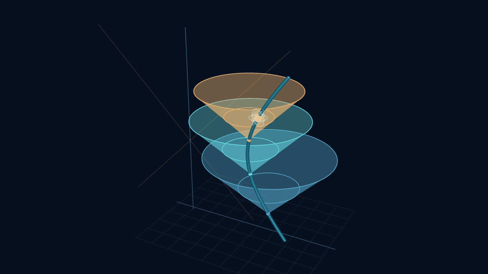
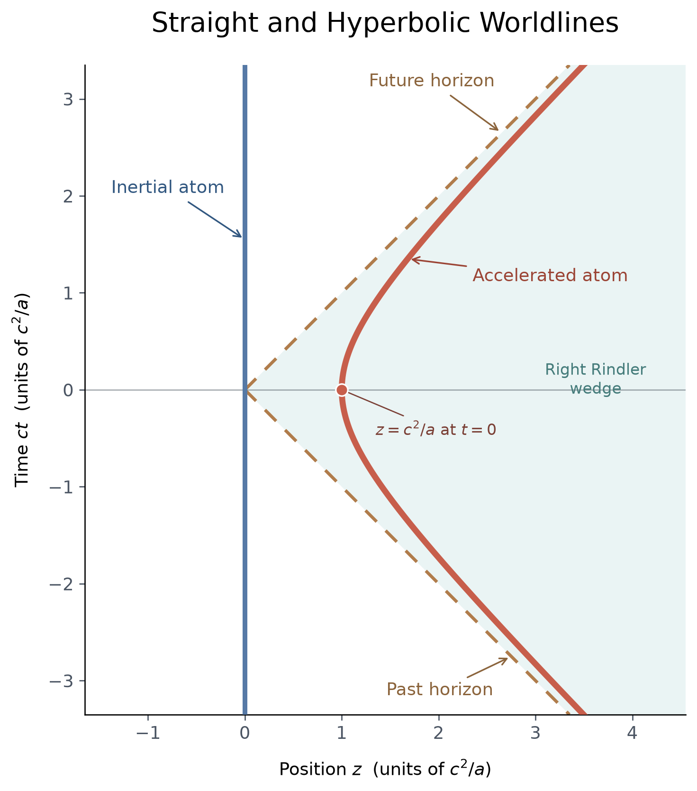
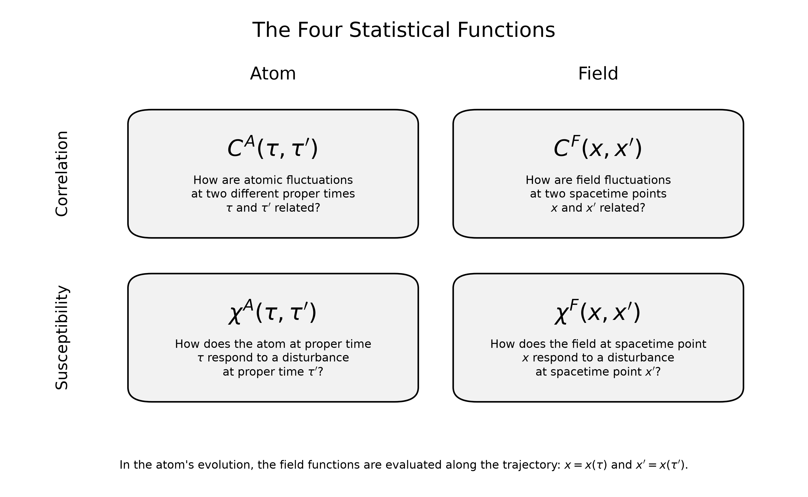
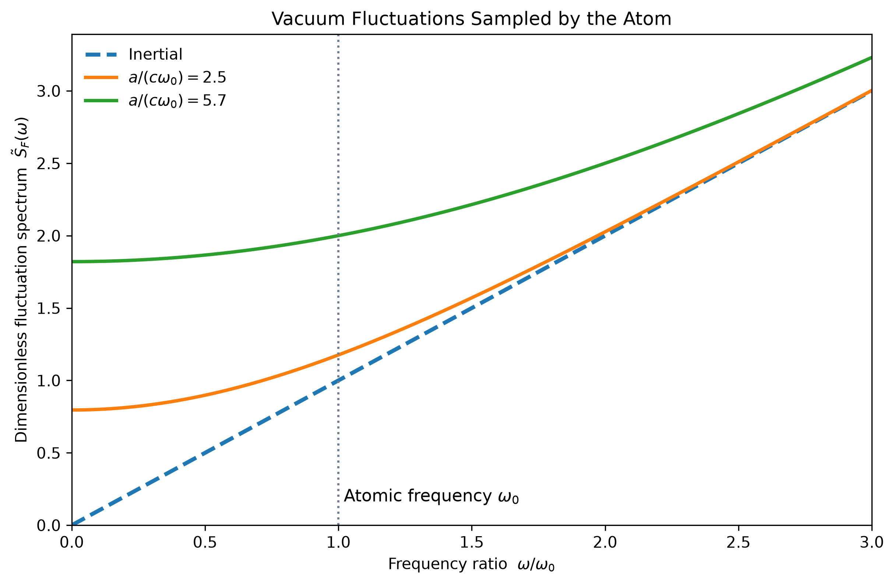
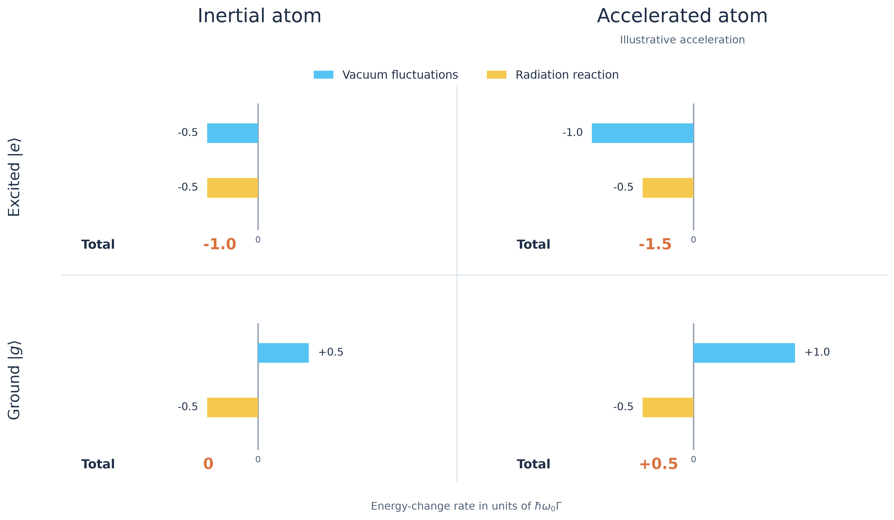
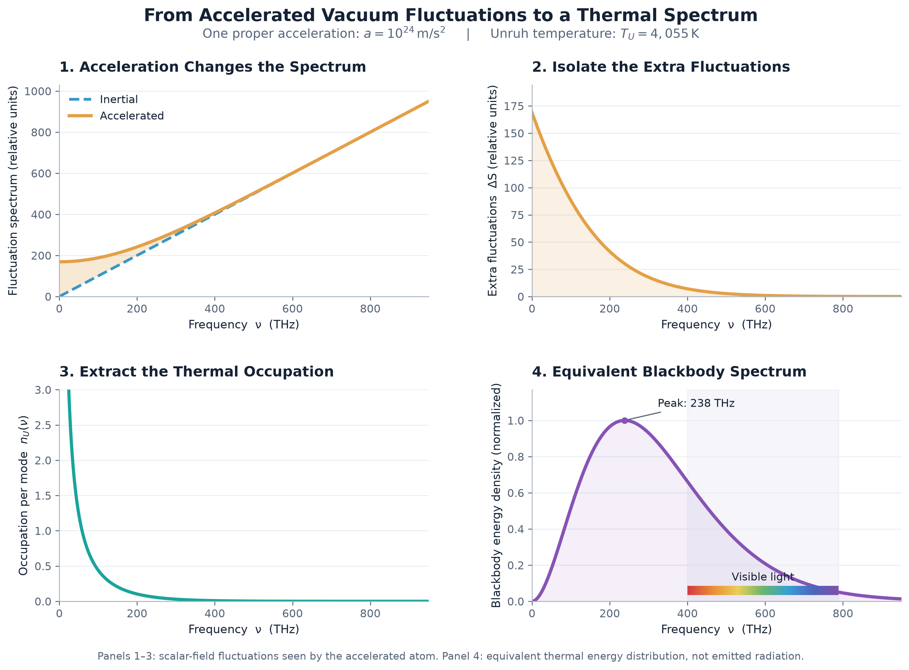

<!--
POST 4 — MEDIUM PUBLISHING METADATA (not article prose)
Status: HUMAN REVIEW / not yet published
Revision: 2026-11-17 — author-voice rewrite with integrated figures

Medium title: What Happens When You Accelerate an Atom?
Medium subtitle: A delicate balance keeps atomic ground states stable. What happens when the atom accelerates?
Medium topics (choose up to five):
  - Quantum Physics
  - Unruh Effect
  - Quantum Field Theory
  - Atomic Physics
  - Spontaneous Emission
SEO title: What Happens When You Accelerate an Atom? The Unruh Effect
SEO description: An accelerating atom experiences vacuum correlations with a thermal response. Follow vacuum fluctuations and radiation reaction to discover the Unruh effect.
Suggested preview title: What Happens When You Accelerate an Atom?
Suggested preview subtitle: A delicate balance keeps atomic ground states stable. What happens when the atom accelerates?
Publication: Science Spectrum (select at publishing time, if approved)
Canonical URL: [leave blank unless an earlier original is the canonical source]
Featured image: atomic_post4_feature.png
Featured-image caption: An atom follows an accelerated worldline through spacetime. Light cones along its path illustrate the causal structure surrounding its motion. Image by author.
Featured-image alt text: Dark three-dimensional spacetime illustration with a luminous turquoise curved worldline and translucent blue and amber light cones around an atom.
Suggested excerpt: An atom in its ground state is stable because vacuum fluctuations and radiation reaction cancel. What happens when it accelerates through the same quantum vacuum? Following an idealized two-level atom reveals the thermal response known as the Unruh effect.
Notes: Upload figures separately to Medium; relative Markdown image paths are placeholders for locally stored originals. Figure 3 source PNG was NOT among supplied uploads and should be located before publication. Equations use LaTeX in this canonical Markdown file; prepare image or Unicode equivalents if Medium does not render them.
-->

# How Can an Atom Get Excited When There Are No Photons?
## An atom in its ground state cannot absorb light from empty space. But accelerate it, and it can gain energy. How can motion alone make that possible?

*An atom follows an accelerated worldline through spacetime. Light cones along its path illustrate the causal structure surrounding its motion. Image by author.*

## The Cancellation That Keeps an Atom Stable

Excited atoms emit light, and the properties of that light tell us a great deal about the atom. The process is called spontaneous emission. An excited atom can lose energy and emit a photon even when there is no external radiation to trigger the transition. But an atom in its ground state does not spontaneously absorb energy from the vacuum. We know spontaneous emission, but not spontaneous absorption.

In the previous post, we found that spontaneous emission involves two contributions: vacuum fluctuations and radiation reaction. Vacuum fluctuations originate from the quantum field, which fluctuates even in its lowest energy state. Radiation reaction is the effect of the field produced by the atom acting back on the atom itself.

For an excited atom, both contributions reduce its energy, leading to spontaneous emission. For an atom in its ground state, they act in opposite directions and cancel exactly. In quantum mechanics, the distinction between vacuum fluctuations and radiation reaction is not automatic. Both contribute to the same physical process. Dalibard, Dupont-Roc and Cohen-Tannoudji showed how to separate their contributions consistently [2,3], as we discussed in the previous post.

The cancellation that makes the ground state stable holds for an atom moving at constant velocity. 

> **But what if the atom accelerates?**

The atom's internal energy levels have not changed, and the quantum field is still in the same vacuum state. Only the motion is different. We might therefore expect the cancellation to survive.

It turns out that acceleration changes the balance. A ground-state atom can become excited, even though the field is still in the vacuum state.

We will follow the calculation by Jürgen Audretsch and Rainer Müller [1]. They considered a two-level atom coupled to a massless scalar field rather than the electromagnetic field. This simpler model avoids the complications of polarization and dipole radiation while retaining the physics of vacuum fluctuations and radiation reaction.

We will also assume that the atom undergoes uniform acceleration for an indefinitely long time. This gives a stationary situation in which we can calculate transition rates without having to account for the start and end of the acceleration.

## What Constant Acceleration Looks Like

Acceleration has a slightly different meaning in relativity than in Newtonian mechanics. We need to distinguish the acceleration measured in the laboratory from the acceleration experienced by the atom.

Suppose the atom carries an accelerometer. We arrange for this accelerometer to always read the same value, *a*. This is called **constant proper acceleration**.

An observer in the laboratory sees the atom move faster and faster, approaching the speed of light. The laboratory acceleration gradually decreases, even though the proper acceleration remains constant.

We describe the motion from the laboratory, using time *t* and position *z* along the direction of acceleration. The atom also carries its own clock, which measures its proper time τ.

In relativity, it is convenient to multiply time by the speed of light *c*. This gives *ct*, which has the same unit as position *z*: both are distances. We can then plot the atom’s motion in a spacetime diagram, with *z* on the horizontal axis and *ct* on the vertical axis.

For constant proper acceleration *a*, the position and laboratory time of the atom are related to its own clock by

$$  
\begin{aligned}  
ct(\tau) &= \frac{c^2}{a}\sinh\left(\frac{a\tau}{c}\right),\\[4pt]  
z(\tau) &= \frac{c^2}{a}\cosh\left(\frac{a\tau}{c}\right).  
\end{aligned}  
$$

Here, t(τ) and z(τ) mean the laboratory time and position of the atom when its own clock reads τ.

The two equations can be combined to eliminate τ, giving

$$  
z^2-(ct)^2=\left(\frac{c^2}{a}\right)^2.  
$$

This is the equation of a hyperbola. Figure 1 shows this curved worldline alongside the straight worldline of an atom moving at constant velocity.

*Figure 1. An inertial atom follows a straight worldline. For constant **proper** acceleration, the worldline becomes a hyperbola. The dashed lines are the past and future Rindler horizons of the accelerated trajectory. Image by author.*

At large positive or negative laboratory times, the hyperbola approaches the diagonal lines *z* = ±*ct*. These are the paths followed by light travelling in opposite directions.

The two lines also define causal boundaries for the accelerating atom. A light signal sent from certain regions of spacetime can never catch up with it, however long the atom continues accelerating. Similarly, some regions can never receive a signal from the atom.

These boundaries are called **Rindler horizons**. They arise because we have assumed the atom continues accelerating forever. If the acceleration stops after a finite time, the atom no longer has these exact horizons.

> **Rindler horizons describe which events can communicate with an observer following the complete accelerated trajectory.**

We now have the atom's worldline. The question is how this changes its interaction with the quantum field.

## What Changes when the Atom Accelerates?

Four statistical functions describe the interaction between the atom and the field. Two describe the atom, and two describe the field.

For each system, we distinguish a correlation function and a susceptibility.

The correlation function tells us how fluctuations at two different times or positions are related. The susceptibility describes how a system responds to a disturbance.

*Figure 2. The four statistical functions. The atomic functions depend on the atom's proper times τ and τ′. The field functions depend on two spacetime points x and x′. The atom samples these field functions along its worldline. Image by author.*

For the atom, the functions are

$$
C^A(\tau,\tau'),\qquad \chi^A(\tau,\tau').
$$

For the field, they are

$$
C^F(x,x'),\qquad \chi^F(x,x').
$$

Note the difference in the arguments: the atom's internal dynamics are described using its proper time. The field exists throughout spacetime.

When the atom interacts with the field, the two spacetime positions are fixed by the atom's trajectory:

$$
x=x(\tau),\qquad x'=x(\tau').
$$

In the expressions for the atomic energy evolution, vacuum fluctuations combine the field correlation with the atomic susceptibility. Radiation reaction combines the field susceptibility with the atomic correlation.

Schematically,

$$
\begin{aligned}
\text{Vacuum fluctuations:}\quad
& C^F\,\partial_\tau\chi^A,\\[4pt]
\text{Radiation reaction:}\quad
& \chi^F\,\partial_\tau C^A.
\end{aligned}
$$

The complete expressions involve integrals over the atom's earlier proper times, but these two combinations contain the distinction we need.

The atomic functions depend on the internal structure of the atom. In our idealized model, acceleration does not change that structure, so both atomic functions remain the same.

What about the field susceptibility?

For a massless scalar field in four-dimensional flat spacetime, the field's response is confined to the light cone. Two different points along the atom's trajectory are timelike separated, so a sharp field disturbance at one point cannot propagate at the speed of light and meet the atom again at another point on the same trajectory.

There is still a local contribution where the two points coincide. This requires some care because the field response is singular there. Audretsch and Müller evaluated the corresponding radiation-reaction term and found that it remains unchanged under uniform acceleration [1].

> **So, out of the four contributions three do not change when the atom accelerates. That leaves the field correlation function.**

The vacuum state itself is unchanged, but the atom now samples its correlations along a hyperbolic trajectory rather than a straight one. This affects the field correlations, as seen by the atom.

## Acceleration Changes the Vacuum Fluctuations Sampled by the Atom

Consider two events along the atom's trajectory, separated by a proper-time interval

$$
u=\tau-\tau'.
$$

For an inertial atom, the symmetric correlation function of a massless scalar field in the vacuum has a characteristic dependence

$$
C^F_0(u)\propto-\frac{1}{u^2},
$$

away from the singular point *u* = 0. The full expression must be understood as a distribution, with a prescription for handling that singularity.

For the accelerated atom, we substitute its hyperbolic worldline into the same vacuum correlation function. Away from coincidence, this gives

$$
C^F_a(u)\propto
-\frac{(a/c)^2}
{\sinh^2\left(\dfrac{au}{2c}\right)}.
$$

The two expressions are different because the atom visits a different sequence of spacetime points. In both cases, however, we are calculating correlations in exactly the same Minkowski vacuum.

We can see the change more directly by looking at the frequency spectrum.

The atom has a transition frequency ω₀, measured using its own proper time. Its susceptibility oscillates at this frequency, so the atom responds to the corresponding frequency components of the field fluctuations.

For the inertial scalar field, the symmetric vacuum-fluctuation spectrum is proportional to frequency:

$$
S_0(\omega)\propto|\omega|.
$$

Why does the spectrum increase linearly?

In three spatial dimensions, the number of available massless field modes per frequency interval increases as ω². Each mode behaves like a quantum harmonic oscillator, whose vacuum field-amplitude variance is proportional to 1/ω.

Multiplying the two contributions gives

$$
\omega^2\times\frac{1}{\omega}\propto\omega.
$$

This is the spectrum of the scalar field used in our model. For the electromagnetic electric field, the corresponding inertial vacuum spectrum has a different frequency dependence, proportional to ω³.

For the accelerated atom, the scalar spectrum becomes

$$
S_a(\omega)=
S_0(\omega)
\coth\left(\frac{\pi c|\omega|}{a}\right).
$$

*Figure 3. The inertial scalar-field vacuum spectrum increases linearly with frequency. Acceleration enhances the fluctuations sampled by the atom. The dotted line indicates the atomic transition frequency ω₀. For the green curve, a/(cω₀) ≈ 5.7, and the fluctuation strength at ω₀ is doubled. Image by author.*

Figure 3 shows the inertial spectrum and the spectra for two values of acceleration.

At high frequencies, the accelerated curves approach the inertial straight line. For frequencies comparable to or smaller than *a/c*, the fluctuations are enhanced.

The value of the spectrum at ω₀ determines the vacuum-fluctuation contribution to the atomic energy change. We can therefore use the curves to predict what happens to the balance between vacuum fluctuations and radiation reaction.

## Acceleration Breaks the Balance

We already know that radiation reaction is unchanged. The vacuum-fluctuation contribution, however, increases with acceleration.

For the green curve in Figure 3, we have chosen

$$
\frac{a}{c\omega_0}
=\frac{2\pi}{\ln 3}
\approx5.72.
$$

At this acceleration, the symmetric fluctuation spectrum at ω₀ is exactly twice its inertial value.

Figure 4 compares the contributions to the energy change for the inertial and accelerated atom. We express the rates in units of ℏω₀Γ, where Γ is the spontaneous decay rate of the inertial atom.

*Figure 4. Vacuum fluctuations (cyan) and radiation reaction (yellow) contribute to the energy change of the atom. For the chosen acceleration, the vacuum-fluctuation contribution doubles while radiation reaction remains unchanged. The ground-state cancellation disappears, and the excited atom decays faster. Image by author.*

For the inertial ground state, vacuum fluctuations contribute +0.5 and radiation reaction contributes −0.5. The total is zero, so the atom remains in its ground state.

For the accelerated ground state, vacuum fluctuations contribute +1 while radiation reaction still contributes −0.5. The total becomes +0.5.

The atom can now gain internal energy and make a transition to its excited state.

For the excited state, both contributions reduce the atomic energy. Acceleration makes the vacuum-fluctuation contribution more negative, while radiation reaction stays the same. The total energy-loss rate changes from −1 to −1.5.

So acceleration makes an excited atom decay faster, but it also allows a ground-state atom to become excited.

This is possible without changing the quantum state of the field. The different trajectory is sufficient to change the field correlations experienced by the atom and break the cancellation.

Where does the energy needed to excite the atom come from? Maintaining the acceleration requires an external force. The agent applying that force can supply energy to the combined atom-field system. The atom is not drawing energy from an unlimited reservoir hidden in the vacuum.

We have established that acceleration increases the fluctuations sampled by the atom. But the frequency dependence in Figure 3 suggests something more specific. If we subtract the ordinary inertial fluctuations, what remains?

## The Extra Fluctuations Reveal a Temperature

The accelerated spectrum contains the factor

$$
\coth\left(\frac{\pi c\omega}{a}\right).
$$

For positive frequency, we can rewrite it as

$$
\coth\left(\frac{\pi c\omega}{a}\right)
=
1+\frac{2}{e^{2\pi c\omega/a}-1}.
$$

The accelerated spectrum therefore becomes

$$
S_a(\omega)=
S_0(\omega)
\left[
1+\frac{2}{e^{2\pi c\omega/a}-1}
\right].
$$

The first term is the inertial vacuum spectrum. The second represents the additional fluctuations associated with acceleration.

Subtracting the inertial spectrum and dividing the remaining contribution by twice the inertial spectral weight gives

$$
n_U(\omega)=
\frac{1}{e^{2\pi c\omega/a}-1}.
$$

This expression is identical in form to the Bose–Einstein occupation number for a bosonic mode in a thermal bath:

$$
n_T(\omega)=
\frac{1}{e^{\hbar\omega/(k_BT)}-1}.
$$

Here *T* is the temperature, *k*₍B₎ is Boltzmann's constant, and ℏω is the energy of one quantum.

Comparing the two expressions gives

$$
T_U=\frac{\hbar a}{2\pi ck_B}.
$$

This is the **Unruh temperature**.

The additional fluctuations sampled by a uniformly accelerated atom have the same frequency dependence as the thermal occupation of a bosonic field at this temperature.

Figure 5 shows how this thermal spectrum emerges from the accelerated vacuum correlations.

*Figure 5. The accelerated vacuum spectrum can be separated into the inertial spectrum and an additional contribution. Dividing the additional spectral density by its scalar-field frequency factor gives the Bose–Einstein occupation number. The final panel shows the equivalent blackbody energy distribution, not radiation emitted by the Minkowski vacuum. The acceleration is 10²⁴ m/s², corresponding to an Unruh temperature of approximately 4,055 K. Image by author.*

The first panel shows the inertial and accelerated spectra, with the difference shaded. The second shows only this additional spectral density.

The additional fluctuations still carry the frequency dependence of the scalar field. When we divide out this factor, we obtain the occupation number in the third panel.

The last panel takes the same thermal occupation number and constructs the energy distribution of an equivalent blackbody. The two are not the same quantity.

A blackbody has more available electromagnetic modes at higher frequencies, with a mode density proportional to ω². Multiplying by the energy ℏω of each quantum gives the familiar energy-density spectrum proportional to

$$
\frac{\omega^3}{e^{\hbar\omega/(k_BT_U)}-1}.
$$

This spectrum has a maximum, while the occupation number itself decreases continuously with frequency.

Figure 5 uses ordinary frequency ν = ω/(2π), measured in THz, rather than angular frequency. The corresponding energy of a quantum is *hν*.

For an acceleration of

$$
a=10^{24}\ {\rm m/s^2},
$$

the Unruh temperature is approximately 4,055 K. The equivalent blackbody spectrum per unit frequency peaks near 238 THz, in the infrared.

This acceleration is enormous. For an acceleration equal to the gravitational acceleration at Earth's surface, the Unruh temperature would be approximately

$$
T_U\approx4\times10^{-20}\ {\rm K}.
$$

It is also important to distinguish a thermal detector response from thermal radiation. The final panel does not imply that an inertial observer sees the Minkowski vacuum radiating like a blackbody. The thermal spectrum describes the response of the uniformly accelerated detector.

Our exact result also assumes that the acceleration continues indefinitely. A detector accelerated for a finite time can have additional transient effects, and its response need not be exactly thermal.

## What Does the Atom Actually Do?

We have found a thermal occupation number, but we started with a question about atomic transitions. Does the accelerated atom behave like an atom placed in a thermal bath?

For our scalar two-level model, the answer is yes, in the sense of its stationary transition rates.

Let Γ be the spontaneous decay rate of an inertial atom in vacuum, and let *n*ᵤ(ω₀) be the Unruh occupation number at its transition frequency.

The upward transition rate is

$$
\Gamma_\uparrow=\Gamma\,n_U(\omega_0).
$$

For an inertial atom in vacuum, *n*ᵤ is zero and there are no upward transitions. For an accelerated atom, *n*ᵤ is positive, so the ground state can become excited.

The downward transition rate is

$$
\Gamma_\downarrow
=\Gamma\,[1+n_U(\omega_0)].
$$

We have encountered the familiar **n + 1** factor before. The 1 represents spontaneous emission, while *n* describes the additional stimulated contribution. Acceleration makes the effective occupation number nonzero.

Taking the ratio of the two rates gives

$$
\frac{\Gamma_\uparrow}{\Gamma_\downarrow}
=
e^{-2\pi c\omega_0/a}
=
e^{-\hbar\omega_0/(k_BT_U)}.
$$

This is the same ratio we would obtain for an atom in thermal equilibrium at temperature *T*ᵤ.

If the atom remains uniformly accelerated and coupled to the field for sufficiently long, its excited- and ground-state populations approach the corresponding thermal ratio. The total population-relaxation rate involves both upward and downward transitions, Γ↑ + Γ↓, rather than just the downward decay rate.

The connection with a thermal bath is therefore more than a resemblance between two spectra. It also appears in the actual transition probabilities of the atom.

We should, however, remember the simplifications in our model. A real atom interacts with the electromagnetic field through its electric dipole. Electromagnetic calculations can produce additional acceleration-dependent factors in the absolute transition rates. In that case, the separate radiation-reaction contribution need not remain unchanged, even though the thermal detailed-balance relation survives in the ideal stationary setting [7].

The distinction between the detector's response and the radiation observed in the laboratory also remains important. An accelerating atom can become excited even when an inertial observer describes the field as being in its vacuum state. This does not require the laboratory observer to see a bath of thermal photons.

## Why Does Acceleration Produce a Thermal Spectrum?

We derived the thermal occupation number from the field correlation function. But there is another aspect of the accelerated trajectory that helps explain the result.

Consider a plane wave travelling in the positive *z* direction. In the laboratory, its phase is

$$
e^{-i\omega(t-z/c)}.
$$

The wave has a fixed frequency ω with respect to laboratory time.

Along the atom's accelerated trajectory, however, we have

$$
t-\frac{z}{c}
=
-\frac{c}{a}e^{-a\tau/c}.
$$

Substituting this into the wave gives

$$
\exp\left[
i\frac{\omega c}{a}e^{-a\tau/c}
\right].
$$

The phase is no longer proportional to the atom's proper time τ. Its rate of change decreases exponentially.

So a wave with a fixed frequency in the laboratory does not have a fixed frequency when sampled by the accelerated atom. The atom encounters a continuously changing, or *chirped*, wave.

In quantum field theory, this has an important consequence. A field mode with only positive frequency with respect to laboratory time is not, in general, made up of only positive frequencies when decomposed using the time coordinate of an accelerated observer.

Positive and negative frequencies become mixed. The coefficients describing this transformation are called **Bogoliubov coefficients**.

The thermal spectrum does not follow from a single chirped plane wave. It emerges when we consider all the field modes and their quantum correlations. But the exponential relation between laboratory time and the atom's proper time helps explain why the frequency spectrum changes in such a particular way.

The same kind of exponential frequency relation appears in the derivation of Hawking radiation from black holes.

There are important differences between the two situations. Our atom accelerates through flat spacetime, and the thermal spectrum describes its detector response. Hawking radiation involves a gravitational horizon and an outgoing radiation flux that can be measured far from a black hole.

Yet both calculations involve horizons and a mixing of positive and negative frequencies.

We started with an atom whose ground state was stable because vacuum fluctuations and radiation reaction cancelled. Acceleration changes the field correlations sampled by the atom, breaking that balance. For constant acceleration, the resulting transition rates are precisely those of a thermal bath at the Unruh temperature.

The horizon in our calculation belongs to an accelerated observer in otherwise flat spacetime. Around a black hole, the horizon is a property of the spacetime geometry itself.

What changes when we replace acceleration through flat spacetime with gravity around a black hole?

## References

1. J. Audretsch and R. Müller, *Spontaneous excitation of an accelerated atom: The contributions of vacuum fluctuations and radiation reaction*, Physical Review A **50**, 1755–1763 (1994). https://doi.org/10.1103/PhysRevA.50.1755

2. J. Dalibard, J. Dupont-Roc and C. Cohen-Tannoudji, *Vacuum fluctuations and radiation reaction: Identification of their respective contributions*, Journal de Physique **43**, 1617–1638 (1982). https://doi.org/10.1051/jphys:0198200430110161700

3. J. Dalibard, J. Dupont-Roc and C. Cohen-Tannoudji, *Dynamics of a small system coupled to a reservoir: Reservoir fluctuations and self-reaction*, Journal de Physique **45**, 637–656 (1984). https://doi.org/10.1051/jphys:01984004504063700

4. S. A. Fulling, *Nonuniqueness of canonical field quantization in Riemannian space-time*, Physical Review D **7**, 2850–2862 (1973). https://doi.org/10.1103/PhysRevD.7.2850

5. P. C. W. Davies, *Scalar particle production in Schwarzschild and Rindler metrics*, Journal of Physics A **8**, 609–616 (1975). https://doi.org/10.1088/0305-4470/8/4/022

6. W. G. Unruh, *Notes on black-hole evaporation*, Physical Review D **14**, 870–892 (1976). https://doi.org/10.1103/PhysRevD.14.870

7. Z. Zhu, H. Yu and S. Lu, *Spontaneous excitation of an accelerated hydrogen atom coupled with electromagnetic vacuum fluctuations*, Physical Review D **73**, 107501 (2006). https://doi.org/10.1103/PhysRevD.73.107501

8. L. C. B. Crispino, A. Higuchi and G. E. A. Matsas, *The Unruh effect and its applications*, Reviews of Modern Physics **80**, 787–838 (2008). https://doi.org/10.1103/RevModPhys.80.787
